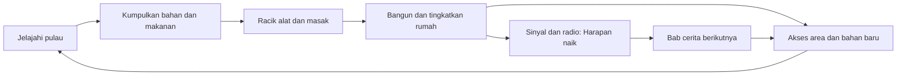
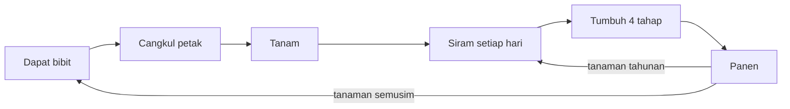

# 01 · Game Design Document: *Terdampar*

| | |
|---|---|
| Versi | 0.1 (draft untuk review) |
| Tanggal | Oktober 2026 |
| Dokumen terkait | [Konten & Balancing](02-content-and-balancing.md) · [Technical Design](03-technical-design.md) · [Art Direction](04-art-direction.md) · [Roadmap](06-roadmap.md) |

Dokumen ini menjelaskan **apa** yang dimainkan dan **kenapa**. Angka-angka seperti laju stat, resep, dan statistik ikan sengaja tidak diulang di sini. Semuanya ada di [Konten & Balancing](02-content-and-balancing.md), supaya setiap angka hanya punya satu sumber.

---

## 1. Ringkasan

**Pitch satu kalimat:** survival santai di pulau tropis Nusantara. Bertahan hidup dengan bekal seadanya, membangun rumah dari alam, dan menjaga harapan sampai bantuan datang.

**Premis.** Bayu (21), nelayan muda, melaut sendirian dengan perahu peninggalan ayahnya. Badai datang tiba-tiba, perahunya rusak dan karam, lalu ia terdampar di pulau tak bernama. Bekalnya hanya pisau lipat, alat pancing, korek gas, serta sedikit makanan dan air. Ia harus bertahan, membuat tempat tinggal, dan mengirim sinyal sampai tim SAR menemukannya.

**Fantasi pemain:** *"Dengan akal dan tanganku sendiri, pulau asing ini pelan-pelan jadi rumah, sampai tiba waktunya pulang."*

| Aspek | Keterangan |
|---|---|
| Genre | Cozy survival, crafting, eksplorasi, dengan cerita ringan |
| Target pemain | Penggemar game cozy (Stardew Valley, Animal Crossing, A Short Hike) yang mau sedikit tantangan; penggemar survival ringan (Raft, Stranded Deep) yang suka suasana tenang |
| Usia | 12+. Tidak ada darah atau kekerasan grafis; berburu ditampilkan dengan lembut |
| Pasar | Indonesia sebagai pasar utama (bahasa dan budaya), terbuka untuk pemain global (bahasa Inggris) |
| Platform | Browser desktop dengan keyboard + mouse; gamepad menyusul |
| Sesi bermain | 20–60 menit; save otomatis setiap kali tidur |
| Durasi | Cerita utama ±16 hari dalam game (±5–8 jam), lalu free play |

**Yang membedakan game ini:**
1. **Nuansa Nusantara yang autentik.** Rumah panggung bambu, atap rumbia, bubu, ikan bakar, papeda, sarung, serta suara tokek dan jangkrik di malam hari.
2. **Air sebening kaca.** Dasar laguna toska terlihat jelas, dunia bawah air bisa dijelajahi, dan plankton bercahaya di malam hari.
3. **Survival yang ramah.** Tantangannya nyata, tapi gagal tidak pernah terasa menghukum.
4. **Langsung main di browser.** Tanpa instalasi dan bisa dibagikan lewat tautan.

---

## 2. Pilar Desain

Setiap fitur baru harus lolos uji keempat pilar ini.

### Pilar 1: Santai tapi Bermakna
Tekanan survival ada untuk memberi tujuan, bukan untuk membuat stres.
- Stat turun pelan, dan peringatan muncul jauh sebelum kondisi berbahaya.
- Selalu ada solusi di dekat pemain (kelapa di pantai, air di mata air).
- Gagal berarti pingsan lalu bangun keesokan paginya, bukan *game over* (kecuali di mode Survival).
- **Uji:** *Apakah fitur ini membuat pemain cemas berkepanjangan? Kalau ya, lunakkan.*

### Pilar 2: Pulau yang Hidup dan Indah
Pemandangan dan suara adalah hadiah itu sendiri.
- Daun dan rumput selalu bergerak pelan, ombak berkilau, awan melintas.
- Hewan kecil seperti kepiting, kupu-kupu, burung, dan cicak mengisi dunia.
- Ada momen untuk sekadar menikmati. Duduk menonton matahari terbenam memberi bonus Semangat.
- **Uji:** *Apakah fitur ini membuat pulau terasa lebih hidup, atau cuma menambah menu?*

### Pilar 3: Akal dari yang Sedikit
Mulai dari bekal seadanya, dan setiap benda punya banyak kegunaan.
- Pisau dipakai untuk memotong serat, membuka kelapa, membersihkan ikan, membuat tombak, sampai memantik api dengan batu api.
- Kaleng sarden bekas jadi panci darurat. Botol bekas jadi wadah air, penyiram, atau kantong udara.
- Pengetahuan bertambah lewat pengamatan, ingatan akan nasihat nenek, dan jurnal penghuni lama pulau.
- **Uji:** *Apakah fitur ini memberi cara kreatif untuk memakai barang yang sudah dimiliki pemain?*

### Pilar 4: Harapan untuk Pulang
Ada tujuan yang hangat dan jelas: pulang ke ibu.
- Meter *Harapan* menunjukkan kemajuan menuju penyelamatan.
- Setiap bab cerita membuka mekanik dan area baru.
- Nada cerita optimis. Kesepian ada, tapi tidak suram.
- **Uji:** *Apakah fitur ini terhubung, langsung atau tidak, dengan perjalanan pulang?*

---

## 3. Cerita

### 3.1 Tema
Kemandirian, kearifan lokal, dan kerinduan pada keluarga. Arc emosional Bayu: **panik → bertahan → betah → berharap → pulang**.

### 3.2 Tokoh

| Tokoh | Peran |
|---|---|
| **Bayu** (21) | Tokoh utama, nelayan muda dari Desa Tanjung Biru (fiktif) di Indonesia timur. Sejak ayahnya meninggal, ia melaut dengan perahu peninggalan ayah, *Harapan Ibu*, untuk membantu ibunya. Optimis, sedikit ceroboh, dan suka menertawakan diri sendiri. Ia sering teringat nasihat neneknya tentang alam ("Kata Nenek..."). Pemain bisa mengganti namanya. |
| **Ibu (Bu Ratna)** | Muncul lewat radio di Bab 4. Motivasi emosional utama Bayu. |
| **Pak Daeng** | Pelaut Bugis yang puluhan tahun lalu terdampar di pulau yang sama dan akhirnya selamat. Ia meninggalkan pondok, kebun yang kini liar, dan jurnal bergambar. Jurnal itu berfungsi sebagai tutorial di dalam cerita, sekaligus bukti bahwa pulang itu mungkin. |
| **Pak Harun** | Operator radio Koperasi Nelayan di desa. Orang pertama yang menangkap panggilan Bayu. |
| **Tim SAR** | Datang bersama nelayan desa di akhir cerita. |

### 3.3 Alur Cerita

| Bab | Judul | Hari | Ringkasan | Mekanik baru |
|---|---|---|---|---|
| Prolog | Pagi di Laut | 0 | Bayu memancing di perahu saat fajar. Radio menyiarkan peringatan cuaca yang putus-putus. Langit menggelap, badai datang, perahu karam. | Gerak, kamera, memancing (tutorial) |
| 1 | Terdampar | 1 | Bangun di pantai. Mengumpulkan puing perahu, minum air kelapa, menyalakan api, dan membuat bivak sebelum gelap. | Stat survival, inventaris, mengumpulkan, meracik, api, tidur |
| 2 | Mengenal Pulau | 2–4 | Mencari mata air, membuat alat batu, memancing di laguna, menemukan pondok dan jurnal Pak Daeng, mulai berkebun, dan memberi nama pulau. | Alat, foraging & identifikasi tanaman, memasak, berkebun, berenang |
| 3 | Rumah di Pulau | 4–8 | Menyelam ke bangkai perahu di laguna untuk mengambil kotak perkakas, membangun rumah panggung, berburu, dan membuat tanda SOS. Sebuah kapal lewat di kejauhan tanpa melihat Bayu. | Mode bangun, berburu, menyelam, meja kerja |
| 4 | Sinyal Harapan | 8–13 | Memperbaiki radio: mengeringkannya, mengambil aki dari buritan perahu yang tenggelam di karang luar, mengambil kawat tembaga, dan membangun antena di puncak bukit. Kontak dengan desa dan suara Ibu. Membangun menara api sinyal. | Menyelam dalam, rantai quest, menara & radio |
| 5 | Pulang | 13–16 | Radio memperingatkan badai. Bayu menyiapkan rumah dan persediaan, bertahan semalam, lalu menyalakan menara api ketika helikopter SAR melintas di pagi yang cerah. | Event badai, persiapan, ending |

> Angka hari hanya panduan. Cerita maju berdasarkan pencapaian (lihat §9), dengan beberapa event terjadwal sebagai penanda waktu.

### 3.4 Prolog: Pagi di Laut
1. **Pukul 05:30 di perahu *Harapan Ibu*.** Laut tenang, langit jingga. Pemain belajar melihat sekeliling dan berganti kamera TPV/FPV.
2. **Tutorial memancing.** Lempar kail dan tangkap dua ikan. Radio berbunyi: *"...peringatan cuaca... perairan timur... segera kembali..."* lalu terputus.
3. **Badai.** Awan gelap bergulung, hujan turun, kilat menyambar. Pemain memegang kemudi menembus ombak dalam sekuens singkat yang tidak bisa gagal. Ombak besar menghantam, lalu layar menghitam.
4. **Bangun di pantai.** Kamera turun perlahan dari langit biru ke pantai pasir putih. Bayu terbangun sambil terbatuk. Bab 1 dimulai.

Durasi prolog 5–8 menit, dan bisa dilewati saat bermain ulang.

### 3.5 Perangkat Narasi
- **Monolog Bayu.** Subtitle singkat yang muncul sesuai konteks ("Haus... kelapa itu kelihatannya segar."). Monolog sekaligus berfungsi sebagai petunjuk halus.
- **Jurnal Pak Daeng.** Sekitar 10 halaman bergambar yang tersebar di pondok, gua, dan tempat lain. Isinya resep, petunjuk tanaman, dan kisah hidupnya.
- **Pesan dalam botol.** 8 surat koleksi dari berbagai orang, ditemukan saat memancing atau di pantai. Isinya cerita-cerita kecil yang hangat.
- **Radio.** Dialog dengan Pak Harun dan Ibu di Bab 4–5.
- **Lingkungan.** Bangkai perahu, nama perahu Pak Daeng yang terukir di tiang pondok, dan bekas api unggun lama.

### 3.6 Ending & Post-game
- **Ending utama.** Helikopter SAR dan perahu nelayan desa menjemput Bayu, lalu cutscene reuni di dermaga desa.
- **Kartu epilog** berbeda sesuai cara bermain: jumlah hari bertahan, rumah yang dibangun, kelengkapan ensiklopedia, penyu yang diselamatkan, dan nama pulau.
- **Free play.** Setelah ending, pemain bisa kembali ke pulau (Bayu kini punya perahu baru) untuk terus membangun, berkebun, dan melengkapi koleksi.
- **Mode Survival + permadeath (opsional).** Pingsan berarti *game over*, lalu tampil ringkasan perjalanan.

---

## 4. Dunia

### 4.1 Pulau
- **Daratan:** ±600 m (barat–timur) × 450 m (utara–selatan). Area laut yang bisa dijelajahi ±1,5 × 1,5 km.
- **Waktu tempuh:** berlari dari ujung ke ujung sekitar 2 menit. Cukup kecil untuk dihafal, cukup besar untuk dijelajahi.
- **Ketinggian:** puncak bukit ±60 m. Dari puncak, seluruh pulau terlihat.
- **Kedalaman air:** laguna 1–4 m, tepi karang 4–6 m, karang luar 6–10 m. Lewat dari karang luar ada laut dalam berarus kuat.

### 4.2 Peta Kasar

```
                              U
                              ^
  ~  ~  ~  ~  ~  ~  ~  ~  ~  ~  ~  ~  ~  ~  ~  ~  ~  ~  ~
  ~  : : : : : : : : [9] Karang Luar : : : : : : : : :  ~
  ~  :   [8] Gosong                 , , , , , , ,    :  ~
  ~  :      (o)             , , , , [6] Bakau , ,    :  ~
  ~  :                . . T T T T T T T T T . .      :  ~
  ~  :           . . T T T T ^ ^ ^ ^ T T T T T . .   :  ~
  ~  :         . T [7] ^ ^ [4]  *  ^ ^ T [5]   T .   :  ~
  ~  :         . T Gua ^ ^ Bukit   ^ ^ T Pondok  T   :  ~
  ~  :         . T T T T ^ = [3] = ^ T T T T T T .   :  ~
  ~  :         . . T T T T = = T T T [2] Hutan  .    :  ~
  ~  :           . . . T T = = T T T T T T . .       :  ~
  ~  :  [10]          . . = = . . . . . .            :  ~
  ~  :  Batu        . . [1] Pantai Karam . .         :  ~
  ~  :  Karang    X . . .      ~ [L] Laguna ~        :  ~
  ~  : : : : : : : : : : : : : : : : : : : : : : : : :  ~
  ~  ~  ~  ~  ~  ~  ~  ~  ~  ~  ~  ~  ~  ~  ~  ~  ~  ~  ~

  ~ laut dalam, arus kuat    : karang luar    . pantai    , bakau
  T hutan    ^ bukit    = sungai & mata air    * puncak    X bangkai perahu
```

### 4.3 Zona

| # | Zona | Ciri | Sumber daya | Hewan | Fungsi gameplay | Fase |
|---|---|---|---|---|---|---|
| 1 | Pantai Karam | Pasir putih, bangkai haluan perahu, pohon kelapa dan ketapang | Kelapa, daun kelapa, kayu apung, batu, kerang, pandan, lidah buaya, barang hanyut | Kepiting, kelomang, burung camar | Titik awal, barang hanyut harian, tanda SOS | Rilis 1.0 |
| L | Laguna | Air dangkal toska (1–4 m), padang lamun, karang kecil, bangkai perahu bagian tengah | Rumput laut, kerang, ikan dangkal, kotak perkakas | Ikan kecil, penyu | Belajar berenang, menyelam, dan memancing | Rilis 1.0 |
| 2 | Hutan Tropis | Pohon besar, rumpun bambu, rotan, semak; cahaya menembus kanopi | Kayu, bambu, rotan, serat, pisang, pepaya, jamur, jahe, kunyit, getah | Ayam hutan, babi hutan, burung, kupu-kupu | Bahan bangunan, berburu, foraging | Rilis 1.0 |
| 3 | Mata Air & Sungai | Kolam kecil, air terjun mini, sungai kecil yang mengalir ke laut | Air tawar, tanah liat, talas, kangkung, ikan wader, udang | Capung, katak | Air bersih, tanah liat | Rilis 1.0 |
| 4 | Bukit & Puncak | Padang rumput, bebatuan, pemandangan 360° | Batu, batu api, mangga | Burung | Menara api, antena radio, spot sunset terbaik | Rilis 1.0 |
| 5 | Pondok Pak Daeng | Reruntuhan pondok berlumut, kebun yang kini liar | Singkong, ubi jalar, halaman jurnal | Ayam hutan | Lore dan bibit pertama | Rilis 1.0 |
| 6 | Rawa Bakau | Akar bakau, lumpur, air payau | Kayu bakau, sagu, kepiting bakau (lewat bubu) | Biawak, kepiting bakau | Konten tambahan (sagu → papeda) | Nanti |
| 7 | Gua Pesisir | Gua di tebing barat, kelelawar | Halaman jurnal terakhir, harta kecil | Kalong | Eksplorasi opsional | Nanti |
| 8 | Gosong Pasir | Pulau pasir kecil, ±2 menit berenang dari pantai | Telur burung, kerang langka | Camar, penyu bertelur | Tantangan renang, event penyu | Nanti |
| 9 | Karang Luar | Karang dalam (6–10 m), batas arus | Ikan besar, mutiara, aki kapal di buritan perahu | Ikan karang, ubur-ubur, hiu (Survival) | Menyelam dalam, batas dunia | Rilis 1.0 |
| 10 | Batu Karang | Formasi batu yang menjorok ke laut | Ikan laut dalam | Camar | Spot memancing laut dalam | Rilis 1.0 |

### 4.4 Lokasi Penting

| Lokasi | Zona | Isi | Bab |
|---|---|---|---|
| Bangkai haluan *Harapan Ibu* | Pantai Karam | Puing awal, kawat tembaga (Bab 4), titik bangun pertama | 1, 4 |
| Kotak perkakas | Laguna, kedalaman 3 m | Palu besi, paku, kacamata selam | 3 |
| Buritan perahu | Karang luar, kedalaman 8–10 m | Aki kapal | 4 |
| Mata air & air terjun kecil | Mata Air | Air tawar, tanah liat, kangkung | 2 |
| Pondok Pak Daeng | Timur pulau | Jurnal, kebun liar, resep cangkul | 2 |
| Puncak bukit | Bukit | Lokasi menara api dan antena; spot sunset terbaik | 4–5 |
| Gua pesisir | Barat | Halaman jurnal terakhir, kalong, harta kecil | Opsional |
| Gosong pasir | Barat laut, lepas pantai | Telur burung, kerang langka, sarang penyu | Opsional |
| Batu Karang | Barat daya | Spot memancing laut dalam | 2+ |

### 4.5 Batas Dunia
- Di luar karang luar, arus kuat mendorong pemain kembali. Bayu bergumam, *"Arusnya terlalu kuat... aku harus balik."*
- Horizon diberi kabut laut tipis. Siluet pulau-pulau lain samar terlihat tapi tidak bisa dijangkau, yang menambah rasa terisolasi sekaligus harapan.
- Tebing yang terlalu curam (lereng > 50°) tidak bisa didaki.

---

## 5. Loop Gameplay



**Loop momen (detik sampai menit):** melihat sesuatu yang menarik → mendekat → mengumpulkan atau berinteraksi → mendapat hasil dengan umpan balik yang memuaskan (suara, partikel, ikon).

**Loop harian (1 hari dalam game = 20 menit nyata):**

| Waktu | Kegiatan khas |
|---|---|
| Pagi (06–10) | Mengecek barang hanyut di pantai, menyiram kebun, mengecek bubu dan jerat, sarapan |
| Siang (10–16) | Menjelajah, mengumpulkan bahan, membangun, memancing, menyelam (air paling jernih) |
| Sore (16–18) | Memasak, menyimpan hasil, duduk menikmati matahari terbenam |
| Malam (18–06) | Tidur untuk melewati malam, atau beraktivitas malam: memancing cumi, mencari kepiting, melihat plankton bercahaya |

**Loop jangka panjang:** alat lebih baik → bahan baru → bangunan dan stasiun baru → sinyal → Harapan naik → bab baru → pulang.

---

## 6. Sistem Survival

### 6.1 Stat

| Stat | Fungsi | Turun karena | Naik karena |
|---|---|---|---|
| Kesehatan | Nyawa; jika 0, Bayu pingsan | Lapar/haus kosong, cedera, racun, kehabisan napas | Pulih sendiri saat kenyang dan cukup minum, tidur, perban, masakan |
| Lapar | Rasa kenyang | Waktu (lebih lambat saat tidur) | Makan |
| Haus | Hidrasi | Waktu, lebih cepat di bawah terik siang | Air bersih, air kelapa |
| Energi | Kantuk dan lelah jangka panjang | Waktu terjaga | Tidur (kualitasnya tergantung tempat tidur) |
| Stamina | Tenaga jangka pendek | Lari, renang cepat, mengayun alat | Istirahat sebentar |
| Oksigen | Napas di bawah air | Menyelam | Kembali ke permukaan |
| Semangat | Mood; memberi buff atau debuff | Tidur di tanah, sakit, kehujanan | Makanan enak, rumah nyaman, matahari terbenam, penemuan, kemajuan cerita |

HUD hanya menampilkan stat yang sedang relevan. Oksigen muncul saat menyelam; stat lain memudar selama aman.

### 6.2 Status

| Status | Pemicu | Efek singkat | Cara pulih |
|---|---|---|---|
| Segar | Tidur nyenyak di kasur | Stamina pulih lebih cepat | Hilang sendiri; durasinya tergantung Kenyamanan rumah |
| Kenyang | Makan masakan khas | Kesehatan pulih lebih cepat | Hilang sendiri |
| Basah | Berenang, kehujanan tanpa atap | Malam terasa lebih melelahkan | Api unggun, sinar matahari |
| Sakit Perut | Makanan mentah, air mentah, tanaman beracun | Muntah berkala (Lapar dan Haus turun) | Teh jahe, istirahat |
| Keracunan | Jamur atau umbi beracun | Kesehatan turun perlahan, pandangan bergoyang | Teh jahe, arang |
| Tersengat | Ubur-ubur | Nyeri, gerak sedikit melambat | Lidah buaya |
| Luka | Diseruduk babi, jatuh dari tempat tinggi | Kesehatan tidak pulih | Perban |
| Lelah | Energi rendah | Stamina maksimum turun, gerak melambat | Tidur |

### 6.3 Pingsan sebagai Pengganti *Game Over*
Saat Kesehatan habis, layar memudar dan Bayu bangun di tempat tidur terakhir (atau di pantai, bila belum punya tempat tidur) pada pagi berikutnya.
- **Normal:** makanan mentah yang dibawa hilang, serta Lapar, Haus, dan Semangat turun. Alat dan bahan tetap ada.
- **Santai:** tidak ada yang hilang.
- **Survival:** sama seperti Normal, dengan opsi permadeath.

### 6.4 Tingkat Kesulitan

| | Santai | Normal | Survival |
|---|---|---|---|
| Laju Lapar/Haus/Energi | Lambat | Standar | Cepat |
| Lapar/Haus kosong melukai | Tidak | Ya | Ya, lebih sakit |
| Makanan basi | Tidak | Ya | Ya, lebih cepat |
| Babi hutan | Tidak menyerang | Menyeruduk jika diganggu | Lebih agresif |
| Hiu di luar karang | Tidak ada | Tidak ada | Ada |
| Bahan kembali saat bangunan dibongkar | 100% | 75% | 50% |
| Permadeath | — | — | Opsional |

Angka pastinya ada di [Konten & Balancing](02-content-and-balancing.md).

### 6.5 Prinsip Survival yang Ramah
1. **Peringatan dini.** Saat stat di bawah 30%, ikon berkedip lembut dan Bayu bergumam ("Perutku keroncongan...").
2. **Tidak ada kematian mendadak.** Setiap bahaya terlihat atau terdengar sebelum melukai: ubur-ubur berkilau, babi mendengus.
3. **Solusi selalu dekat.** Setiap zona punya sumber makanan dan air darurat.
4. **Malam tidak menakutkan.** Malam remang kebiruan, dengan kunang-kunang dan plankton bercahaya. Tidak ada monster.

---

## 7. Bekal Awal & Jam Pertama

### 7.1 Bekal dari Perahu

| Barang | Jumlah | Kegunaan |
|---|---|---|
| Pisau Lipat | 1 | Alat terpenting: memotong serat dan rumput, membuka kelapa, membersihkan ikan, menguliti buruan, membuat tombak kayu, memotong bambu kecil, dan memantik api dengan batu api. Bisa diasah. |
| Alat Pancing (joran ayah) | 1 | Bisa memancing sejak hari pertama. Joran ini punya reel, jadi lebih mudah dipakai daripada joran bambu buatan sendiri. |
| Korek Gas | 1 (30 kali nyala) | Menyalakan api seketika. Jumlah nyalanya terbatas, jadi pemain terdorong menjaga api tetap hidup dan belajar memakai bor api atau pemantik batu api. |
| Biskuit | 3 | Makanan darurat hari pertama |
| Sarden Kaleng | 1 | Makanan; kalengnya bisa jadi panci darurat untuk merebus air |
| Botol Air Mineral (penuh) | 2 | Minum; botolnya bisa jadi wadah air, penyiram, atau kantong udara |

### 7.2 Puing di Pantai (Hari 1)
Di sekitar bangkai haluan ada **Terpal Robek** (atap bivak, penampung hujan, penyuling surya), **Tali** ×2, **Papan** ×3, **Jeriken** (wadah air besar), dan **Radio Rusak** (kunci cerita Bab 4).

### 7.3 Alur 30 Menit Pertama
1. **Bangun di pantai.** Tujuan pertama, *"Periksa tas"*, memperkenalkan inventaris.
2. **Jelajahi bangkai perahu.** Memungut puing mengajarkan cara berinteraksi dan mengambil barang.
3. **Haus.** Monolog mengarahkan pemain ke pohon kelapa. Goyang pohonnya, buka kelapa dengan pisau, lalu minum. Pemain belajar memakai alat dan memahami stat Haus.
4. **Kumpulkan ranting dan batu.** Resep *Api Unggun* terbuka otomatis.
5. **Sore hari.** Tujuannya membuat api unggun dan menyalakannya dengan korek. Pemain belajar membangun stasiun sederhana dan mengelola sumber daya yang terbatas.
6. **Bivak.** Membuat bivak dari ranting dan terpal atau daun kelapa.
7. **Lapar.** Makan biskuit, atau menangkap ikan di tepi pantai lalu membakarnya.
8. **Malam.** Tidur di bivak sampai pagi. Game tersimpan otomatis dan Harapan naik 5%.

---

## 8. Aktivitas Inti

### 8.1 Mencari Tanaman (Foraging)
**Tujuan desain:** eksplorasi yang berhadiah, dengan sedikit risiko dan rasa penemuan.

- **Sumber:** pohon buah (kelapa, pisang, pepaya, mangga), umbi (singkong, talas, ubi jalar), sayur liar (kangkung), jamur, beri, herbal (jahe, kunyit, lidah buaya), dan rumput laut.
- **Identifikasi:** tanaman yang belum dikenal tampil sebagai *"??? (buah merah kecil)"*. Ada tiga cara mengenalinya:
  1. Membaca jurnal Pak Daeng.
  2. **Periksa** (tahan E). Bayu mengingat nasihat neneknya, misalnya *"Kata Nenek, jamur yang warnanya mencolok jangan dimakan."*
  3. Mencicipinya, dengan risiko Sakit Perut atau Keracunan.

  Tanaman yang sudah dikenal masuk ke **Ensiklopedia** lengkap dengan ilustrasi dan catatan.
- **Pengolahan:** beberapa tanaman wajib dimasak. Seperti di dunia nyata, singkong mentah beracun dan talas mentah membuat gatal.
- **Tumbuh kembali:** semak dan pohon kembali berbuah setelah beberapa hari.
- **Sentuhan cozy:** memanjat pohon kelapa (dengan animasi khusus), menggoyang pohon sampai buahnya jatuh, dan kupu-kupu yang beterbangan saat semak disentuh.

### 8.2 Berkebun
**Tujuan desain:** rutinitas harian yang menenangkan sekaligus sumber makanan yang stabil.



- **Sumber bibit:** kebun liar Pak Daeng (singkong, ubi jalar); alam (anakan pisang, biji pepaya, cabai rawit, stek kangkung, rimpang jahe dan kunyit, tunas kelapa); dan peti hanyut yang sesekali membawa benih.
- **Aturan:**
  - Petak harus dicangkul dulu dengan *Cangkul Batu*.
  - Siram sekali sehari. Hujan otomatis menyiram.
  - Tanaman yang tidak disiram 1 hari akan layu dan berhenti tumbuh; setelah 3 hari, tanaman mati.
  - Kompos mempercepat pertumbuhan dan menambah hasil panen.
  - Ayam hutan dan babi bisa merusak kebun yang tidak berpagar. Pagar bambu dan orang-orangan sawah melindunginya.
- **Visual:** setiap tanaman punya 4 tahap pertumbuhan. Tanah kering tampak pucat, tanah basah lebih gelap.
- **Tanaman tahunan** (pisang, pepaya, kelapa) cukup ditanam sekali, lalu terus berbuah.

### 8.3 Berburu
**Tujuan desain:** sumber protein dan bahan (kulit, tulang, bulu) yang menantang, dengan nada tetap lembut.

- **Hewan buruan:** kepiting pantai (mudah), ayam hutan (gesit, perlu jerat atau busur), dan babi hutan (kuat, bisa menyeruduk).
- **Hewan dilindungi:** penyu tidak bisa diburu. Pemain bisa berenang bersamanya dan menjaga sarangnya.
- **Metode:**
  - *Aktif:* tombak (tusuk atau lempar), busur dan panah, ketapel.
  - *Pasif:* jerat di jalur hewan dan bubu di air, yang dicek setiap pagi.
- **Mengendap:** jongkok memperkecil jarak hewan menyadari kehadiran pemain. Hewan kabur bila mendengar langkah berlari.
- **Hasil:** daging (wajib dimasak), kulit (untuk tas kulit), tulang (kail, mata panah), dan bulu (panah).
- **Nada:** tanpa darah. Hewan yang kalah rebah lalu memudar menjadi bundel hasil buruan dengan efek partikel lembut. Populasi pulih perlahan, dan tidak ada panen berlebihan.
- **Bahaya:** babi hutan bisa menyeruduk; Kesehatan berkurang, Bayu terpental, dan bisa mendapat status *Luka*. Ancaman ini bisa dihindari dan selalu didahului tanda, seperti dengusan atau kaki yang menggaruk tanah.

### 8.4 Memancing
**Tujuan desain:** aktivitas santai andalan yang butuh keterampilan dan memuaskan, sekaligus menjadi koleksi.

**Alur:**
1. Pilih joran, **tahan klik kiri** untuk mengisi tenaga lempar, lalu lepas. Kail melayang ke titik yang dibidik.
2. Pelampung naik-turun mengikuti ombak. Tunggu beberapa detik.
3. **Strike:** pelampung tenggelam, terdengar bunyi "plup", dan layar bergetar halus. Klik di jendela waktu yang tepat.
4. **Tarik-ulur:** ada bar tegangan dengan zona hijau. Tahan klik untuk menggulung (tegangan dan progres naik), lepas untuk mengendurkan. Ikan memberontak secara acak sesuai sifat spesiesnya. Kalau tegangan mentok terlalu lama, senar putus.
5. **Hasil:** ikan dengan ukuran acak (rekor pribadi tercatat di Ensiklopedia), sampah lucu (sandal jepit, kaleng), atau **pesan dalam botol**.

- **Variabel:** zona dan kedalaman di titik pelampung (pantai, laguna, tepi karang, laut dalam, sungai, bakau), jam, cuaca, umpan, dan kualitas joran.
- **Cara lain:** tombak ikan saat menyelam, dan bubu (perangkap bambu tradisional) yang dicek setiap pagi.
- **Pengolahan:** bersihkan dengan pisau, lalu bakar, keringkan, atau asinkan.
- **Lepaskan:** spesies dilindungi (ikan napoleon) dan ikan badut hanya bisa dilepas. Melepaskannya memberi Semangat dan entri Ensiklopedia.
- **Joran & umpan:** joran ayah (bawaan, terbaik di awal) → joran bambu (buatan sendiri, cadangan kalau joran ayah rusak). Umpan mempersingkat waktu tunggu, dan umpan potongan ikan menambah peluang mendapat ikan langka.

### 8.5 Berenang & Menyelam
**Tujuan desain:** memamerkan air bening dan dunia bawah laut, membuka konten cerita, dan memberi ketegangan kecil yang tetap aman.

- **Di permukaan:** WASD untuk berenang, Shift untuk renang cepat (memakai stamina). Saat stamina habis, Bayu **mengapung telentang**: aman tapi lambat. Tidak ada tenggelam di permukaan.
- **Menyelam:** Ctrl untuk turun, Space untuk naik. Ada meter **Oksigen**. Bila habis, Kesehatan turun cepat dan Bayu otomatis naik ke permukaan. Pingsan di bawah air membuat Bayu bangun di pantai.
- **Peningkatan:** *Kacamata Selam* (dari kotak perkakas) membuat pandangan bawah air jernih; tanpa kacamata, pandangan buram dan jarak pandang pendek. *Kantong Udara* dari botol bekas menambah waktu napas.
- **Isi bawah laut:** rumput laut, kerang, mutiara, ikan untuk ditombak, kotak perkakas, aki kapal, dan harta kecil.
- **Bahaya:** ubur-ubur (Tersengat), arus kuat di luar karang (batas dunia), dan hiu yang hanya ada di mode Survival.
- **Visual:** cahaya kaustik menari di pasir, sinar matahari menembus air (*god rays*), gelembung, dan suara yang teredam. Malam hari, plankton bercahaya di ombak.

### 8.6 Membangun
**Tujuan desain:** mengubah pulau menjadi rumah. Bangunan juga menjadi alasan utama untuk mengumpulkan bahan.

**Tingkatan:**

| Tier | Contoh | Bahan utama | Alat wajib |
|---|---|---|---|
| 0, Darurat | Bivak, api unggun, kasur daun | Ranting, daun kelapa, terpal, batu | — |
| 1, Bambu | Rumah panggung bambu, dinding anyaman, atap rumbia, tangga | Bambu, rotan, tali, panel atap rumbia | Palu (batu atau besi) |
| 2, Kayu | Lantai dan dinding papan, pintu kayu | Papan, paku | Palu + gergaji |
| 3, Batu (akhir, opsional) | Fondasi batu, dinding bata, sumur | Batu, bata, tanah liat | Palu |

**Alat dan bahan harus dicari.** Kapak, palu, beliung, dan cangkul dibuat dari batu, ranting, dan tali. Parang dan gergaji butuh besi rongsok dari barang hanyut. Palu besi dan paku pertama ada di kotak perkakas yang tenggelam di laguna; paku tambahan datang dari peti hanyut.

**Mode Bangun (tombol B):**
1. Pilih kategori (Struktur, Atap, Perabot, Stasiun, Dekorasi), lalu pilih bagiannya.
2. *Ghost preview* muncul. Hijau berarti bisa dipasang; merah berarti tidak, lengkap dengan alasannya (misalnya "Butuh tiang penopang").
3. Bagian menempel otomatis ke grid 2 m dan ke soket bangunan lain (*snap*). Tekan **R** untuk memutar.
4. Klik untuk memasang. Bahan diambil dari tas **dan dari peti di dekatnya**, sebuah kemudahan khas game cozy.
5. Tekan **X** untuk membongkar; sebagian bahan kembali.

**Aturan struktur yang sederhana:** lantai butuh tiang, fondasi, atau tanah datar; dinding berdiri di atas lantai atau fondasi; atap butuh dinding atau tiang. Tidak ada simulasi runtuh.

**Rumah panggung di atas air dangkal** diperbolehkan, dengan tiang di air sedalam maksimal 1,5 m. Idenya terinspirasi rumah panggung suku Bajau.

**Kenyamanan:** perabot dan dekorasi menaikkan nilai *Kenyamanan* di sekitar tempat tidur. Makin nyaman, makin lama buff *Segar* setelah tidur dan makin besar tambahan Semangat. Contoh perabotnya: ranjang bambu, hammock, tikar pandan, pelita minyak kelapa, lonceng angin dari kerang, dan pot bunga.

**Fungsi bangunan:** tempat tidur (titik bangun dan save), penyimpanan, stasiun kerja, serta perlindungan dari hujan dan badai. Tanaman di bawah atap aman, dan Bayu tidak menjadi *Basah*.

### 8.7 Meracik & Memasak
**Racik bertingkat:**

| Tempat | Contoh hasil |
|---|---|
| Tangan (di mana saja) | Tali, kapak batu, tombak kayu, obor, jerat, perban, tas anyaman |
| Meja Kerja | Papan, parang, gergaji, busur dan panah, joran bambu, bubu, peti |
| Api Unggun / Tungku Masak | Ikan bakar, singkong bakar, air matang, sup ikan kuah kuning, teh jahe |
| Rak Pengering | Ikan kering, ikan asin, dendeng, rumput laut kering |
| Tungku Tanah Liat | Periuk, kendi, bata, arang |
| Tambak Garam, Penyuling Surya, Penampung Hujan | Garam dan air bersih |

- **Membuka resep:** resep terbuka otomatis saat pemain pertama kali memegang bahan kuncinya. Misalnya, mengambil batu dan ranting membuka *Kapak Batu*. Resep juga terbuka lewat jurnal Pak Daeng dan cerita, jadi pemain tidak perlu menebak-nebak.
- **Masakan khas Nusantara** memberi buff: ikan bakar, sup ikan kuah kuning, pepes ikan (dibungkus daun pisang), tumis kangkung, teh jahe, dan papeda dari sagu (konten tambahan).
- **Api:** api unggun butuh bahan bakar (ranting, kayu, sabut, arang) dan bisa padam. Api bisa dinyalakan dengan korek (terbatas), bor api (minigame singkat), atau pemantik batu api dengan pisau.
- **Makanan basi:** makanan mentah cepat basi, makanan matang lebih awet, dan makanan kering atau asin tidak basi. Mode Santai menonaktifkan sistem basi.
- **Durabilitas alat:** cukup longgar. Alat bisa diperbaiki di meja kerja, dan pisau diasah dengan batu asah.

### 8.8 Air Bersih
Air adalah kebutuhan paling mendesak, jadi sumbernya terbuka bertahap:

| Sumber | Kapan tersedia | Catatan |
|---|---|---|
| Air mineral bawaan | Hari 1 | Terbatas (2 botol) |
| Air kelapa | Hari 1 | Aman. Perlu pisau atau batu untuk membuka kelapa |
| Mata air | Hari 2 | Rebus dulu supaya aman; air mentah berisiko Sakit Perut |
| Penampung hujan | Hari 3+ | Aman, tapi tergantung cuaca |
| Penyuling surya | Hari 4+ | Mengubah air laut menjadi air tawar dengan lambat; paling efektif saat cerah |
| Sumur (tier 3) | Akhir permainan | Air bersih di dekat rumah |

Air laut tidak boleh diminum karena justru menambah haus. Wadah air: botol plastik, batok kelapa, tabung bambu, kaleng, kendi, dan jeriken.

---

## 9. Progresi & Sistem Harapan

### 9.1 Progresi Tanpa Level
Tidak ada XP atau level. Kemajuan pemain terasa lewat:
- **Alat:** dari tangan kosong, ke alat batu, lalu alat besi.
- **Bangunan:** dari bivak ke rumah panggung yang nyaman.
- **Pengetahuan:** ensiklopedia tanaman, ikan, hewan, resep, dan pesan botol.
- **Cerita:** bab baru membuka area dan tujuan baru.
- *(Opsional, nanti)* **Kebiasaan:** keterampilan pasif yang naik lewat latihan. Misalnya, sering menyelam membuat napas sedikit lebih panjang.

### 9.2 Meter Harapan
Meter *Harapan* (0–100%) tampil di jurnal, dan muncul di HUD setiap kali bertambah. Saat mencapai 100%, penyelamatan dimulai.

| Pencapaian | Harapan |
|---|---|
| Melewati malam pertama | +5% |
| Menemukan air tawar | +5% |
| Menemukan pondok Pak Daeng | +5% |
| Rumah panggung selesai (lantai, dinding, atap, pintu, kasur) | +15% |
| Tanda SOS di pantai | +10% |
| Radio diperbaiki | +15% |
| Kontak radio pertama | +15% |
| Menara api sinyal berdiri | +15% |
| Bertahan melewati malam badai | +15% |
| **Total** | **100%** |

**Transisi bab:**

| Bab | Dimulai saat |
|---|---|
| 2 | Malam pertama terlewati |
| 3 | Air tawar dan pondok Pak Daeng sudah ditemukan |
| 4 | Rumah panggung selesai dan tanda SOS sudah dibuat |
| 5 | Kontak radio terjadi dan menara api berdiri; badai datang malam berikutnya |

### 9.3 Event Terjadwal

| Hari | Event | Fungsi |
|---|---|---|
| 1 | Puing perahu di pantai | Bahan awal |
| 3 (pagi) | Peti hanyut berisi paku dan kain | Mendorong pemain mulai membangun |
| 5 (sore) | Kapal kargo melintas jauh di horizon dan tidak melihat Bayu | Motivasi membuat sinyal; momen emosional |
| 7 (pagi) | Peti hanyut berisi kotak P3K | Bantuan kecil |
| 9 | Pesawat melintas tinggi | Kalau menara api sudah berdiri dan dinyalakan, Semangat naik dan muncul petunjuk |
| Setelah kontak | Ibu berbicara lewat radio setiap pukul 19:00 | Momen hangat; Semangat naik |
| Bab 5 | Badai | Klimaks |
| Setelah badai | Helikopter SAR datang di pagi yang cerah | Ending |

### 9.4 Target Pacing

| Bagian cerita | Hari dalam game | Waktu nyata (perkiraan) |
|---|---|---|
| Prolog + Bab 1 | 0–1 | 30–40 menit |
| Bab 2 | 2–4 | 60–90 menit |
| Bab 3 | 4–8 | 90–120 menit |
| Bab 4 | 8–13 | 90–120 menit |
| Bab 5 | 13–16 | 40–60 menit |

---

## 10. Waktu, Cuaca & Event

### 10.1 Siklus Hari
- **1 hari = 20 menit nyata**, bisa diubah di pengaturan (15, 20, atau 30 menit). Siang 06:00–18:00, malam 18:00–06:00.
- **Tidur** bisa dimulai sejak pukul 18:00, atau kapan saja saat Energi rendah, dan berlangsung sampai pukul 06:00. Waktu dilompati, tetapi stat, kebun, dan proses pengeringan tetap dihitung. Selama tidur, laju Lapar dan Haus turun setengahnya.
- **Fajar dan senja** adalah momen visual terbaik: langit jingga kemerahan dan air yang memantulkan matahari.

### 10.2 Cuaca

| Cuaca | Frekuensi | Efek gameplay | Efek visual & audio |
|---|---|---|---|
| Cerah | ±60% | Penyuling surya bekerja maksimal; Haus sedikit lebih cepat di siang terik | Langit biru bersih, air paling bening |
| Berawan | ±20% | Netral | Awan tebal bergerak, bayangan awan melintas di tanah |
| Hujan ringan | ±15% | Kebun tersiram, penampung hujan terisi, ikan lebih mudah menggigit, Bayu menjadi *Basah* bila tidak di bawah atap | Tetes hujan, genangan, permukaan basah mengilap, suara hujan di daun |
| Badai | Event cerita (di Normal ke atas, sesekali acak) | Angin kencang, ombak tinggi, laut berbahaya, tanaman tanpa atap bisa rusak | Kilat, pohon bergoyang kuat, hujan deras |

Setelah hujan, kadang muncul **pelangi**.

### 10.3 Event Kecil Acak
Lumba-lumba melompat di kejauhan; penyu bertelur di pantai pada malam hari (menjaga sarangnya sampai menetas memberi Semangat besar); hujan meteor; burung migrasi singgah; ikan melompat sebagai penanda spot memancing yang bagus; peti hanyut langka.

---

## 11. Kamera & Kontrol

### 11.1 Kamera

| | TPV (default) | FPV |
|---|---|---|
| Posisi | Di belakang bahu, jarak 1,5–7 m (scroll untuk zoom) | Setinggi mata (±1,62 m) |
| Cocok untuk | Menikmati pemandangan, membangun, menjelajah | Memancing presisi, berburu, interaksi detail, imersi |
| Karakter | Seluruh tubuh terlihat | Tangan dan alat terlihat |
| Tabrakan | Kamera maju otomatis agar tidak menembus dinding atau pohon | — |

- Tekan **V** untuk berganti mode. **Scroll** ke dalam sampai mentok juga otomatis masuk ke FPV.
- **Membidik** (busur, lempar tombak, lempar kail) di TPV menggeser kamera ke atas bahu.
- **Mode bangun** menaikkan kamera TPV sedikit agar lebih mudah menata.
- **Menyelam:** efek bawah air aktif saat kamera berada di bawah permukaan.
- **Cutscene** memakai kamera sinematik dengan jalur yang sudah ditentukan.
- **Mode Foto** (nanti): kamera bebas, filter, dan UI disembunyikan.

### 11.2 Kontrol (Keyboard & Mouse)

| Aksi | Tombol |
|---|---|
| Gerak | W A S D |
| Melihat sekeliling | Mouse |
| Lari / renang cepat | Shift (tahan) |
| Lompat / naik saat berenang | Space |
| Jongkok / turun saat menyelam | Ctrl |
| Interaksi / ambil | E (tahan untuk Periksa, memanjat, dll.) |
| Pakai alat / makan / serang | Klik kiri |
| Bidik / aksi kedua | Klik kanan |
| Ganti kamera TPV/FPV | V |
| Zoom kamera (TPV) | Scroll |
| Pilih slot hotbar | 1–8 |
| Tas (inventaris) | Tab |
| Racik | C |
| Mode bangun | B |
| Jurnal | J |
| Peta | M |
| Buang item | G |
| Putar bagian (mode bangun) | R |
| Bongkar (mode bangun) | X |
| Menu / pause | Esc |

Gamepad menyusul di fase polish, dengan pemetaan standar Xbox/PlayStation lewat Gamepad API. Semua tombol bisa diatur ulang.

### 11.3 Opsi Kamera
FOV (60–100°), sensitivitas mouse, invert Y, head bob, posisi bahu kiri/kanan, jarak default TPV, dan **kurangi gerakan** (mematikan head bob, getaran kamera, dan goyangan saat berenang).

---

## 12. UI & UX

### 12.1 Prinsip
- **Minimal dan memudar.** HUD hanya muncul saat relevan.
- **Gaya jurnal yang hangat.** Kertas krem, tinta coklat, ikon lukis tangan, sudut membulat.
- **Kurangi klik.** Meracik dan membangun bisa memakai bahan dari peti di dekat pemain, dan peti punya tombol "ambil semua".

### 12.2 Tata Letak HUD

```
+----------------------------------------------------------+
| Hari 3 - 14:20 - Cerah               Harapan [###--] 35% |
| > Cari sumber air tawar                                  |
|                                                          |
|                                             +3 Ranting   |
|                            +                +1 Batu      |
|                    [E] Ambil kelapa                      |
|                                                          |
| (Sehat) (Lapar) (Haus) (Energi)                          |
|             [1][2][3][4][5][6][7][8]                     |
+----------------------------------------------------------+
```

| Elemen | Posisi | Perilaku |
|---|---|---|
| Hari, jam, cuaca | Kiri atas | Selalu tampil (kecil) |
| Tujuan aktif | Kiri atas, di bawah jam | Bisa disembunyikan |
| Meter Harapan | Kanan atas | Muncul saat bertambah, lalu memudar |
| Notifikasi item | Kanan | Menumpuk, lalu memudar |
| Titik bidik | Tengah | Selalu di FPV; di TPV hanya saat membidik |
| Prompt interaksi | Di bawah titik bidik | Saat ada objek yang bisa diinteraksi |
| Stat (cincin) | Kiri bawah | Muncul saat berubah atau rendah (ada opsi selalu tampil) |
| Stamina | Bar tipis melengkung di dekat karakter | Saat dipakai |
| Oksigen | Tengah atas | Saat menyelam |
| Hotbar | Tengah bawah | Selalu tampil; memudar bila pemain diam lama |

### 12.3 Menu
- **Tas:** grid slot, slot hotbar, dan perlengkapan yang sedang dipakai (topi caping, tas).
- **Racik:** kategori → daftar resep (bahan yang kurang ditandai) → tombol racik (tahan) dan jumlah.
- **Jurnal:** *Tujuan* · *Catatan* (halaman Pak Daeng, monolog penting) · *Ensiklopedia* (Tanaman, Ikan, Hewan, Pesan Botol) · *Peta* (gambar tangan yang terisi seiring penjelajahan).
- **Pengaturan:** grafis (preset dan detail), audio (master, musik, ambience, efek, suara), kontrol, kamera, aksesibilitas, bahasa.

### 12.4 Umpan Balik
Setiap aksi punya umpan balik berlapis: suara, partikel kecil, animasi ikon, dan getaran halus kamera (bisa dimatikan). Objek yang bisa diinteraksi mendapat *highlight* tepi yang lembut saat dibidik.

### 12.5 Tutorial
Kontekstual dan tidak memblokir. Tooltip muncul saat pertama kali relevan, lalu tersimpan di jurnal. Tidak ada layar teks panjang.

---

## 13. Audio
- **Ambience berlapis** per zona dan jam: ombak (volumenya mengikuti jarak ke pantai), angin di daun kelapa, burung hutan (siang), jangkrik, katak, dan **tokek** (malam), suara hujan yang berbeda di daun dan di atap, serta gemericik mata air.
- **Musik:** akustik santai bernuansa Nusantara (sape, kolintang, suling, kecapi, gitar atau ukulele). Musik dinamis mengikuti suasana: pagi ceria, siang tenang, senja hangat, malam lembut, badai tegang, ending haru. Musik tidak diputar terus-menerus; ada jeda hening alami.
- **Efek suara penting:** langkah sesuai permukaan (pasir, rumput, kayu, air), ayunan dan benturan alat, putaran reel, bunyi "plup" pelampung, api unggun, lonceng angin kerang, dan suara kertas di UI.
- **Bawah air:** semua suara diredam, ditambah dengung laut dan gelembung.
- **Suara tokoh:** versi awal memakai teks dan gumaman pendek. Voice over (TTS atau aktor) dipertimbangkan nanti.

---

## 14. Aksesibilitas & Lokalisasi
- **Bahasa:** Indonesia (utama) dan Inggris sejak awal, lewat sistem i18n.
- Subtitle selalu tersedia, dengan ukuran teks yang bisa diatur.
- Semua tombol bisa diatur ulang, dengan opsi tahan atau tekan-alih (*toggle*) untuk lari, jongkok, dan membidik.
- Mode Santai untuk pemain yang ingin bermain tanpa tekanan.
- Opsi **kurangi gerakan** untuk pemain yang mudah pusing.
- Informasi tidak hanya disampaikan lewat warna; setiap status punya ikon dan bentuk berbeda.
- Game bisa di-pause kapan saja.

---

## 15. Ruang Lingkup (MoSCoW)

| Prioritas | Fitur |
|---|---|
| **Must** (rilis 1.0) | Pulau dengan zona 1–5, Laguna, Karang Luar, dan Batu Karang · stat dan status survival · bekal awal · foraging + ensiklopedia · berkebun (6+ tanaman) · berburu (kepiting, ayam hutan, babi hutan) · memancing (12+ jenis ikan, minigame, bubu) · berenang dan menyelam · membangun tier 0–2 + perabot + kenyamanan · meracik dan memasak · siklus hari, hujan, dan badai · cerita Prolog sampai Bab 5 + meter Harapan · kamera TPV dan FPV · save/load · bahasa Indonesia dan Inggris · 3 tingkat kesulitan |
| **Should** | Rawa bakau dan sagu/papeda · gua pesisir · gosong pasir dan penyu bertelur · tier 3 batu · mode foto · gamepad · voice over Bayu |
| **Could** | Rakit untuk menjelajah sekitar pulau · memelihara ayam hutan · keterampilan pasif · musim buah · achievement |
| **Won't** (untuk sekarang) | Multiplayer · mobile/touch · pulau prosedural · editor modding |

---

## 16. Referensi

| Game | Yang diambil |
|---|---|
| Tchia | Suasana pulau tropis, air, eksplorasi santai, budaya lokal |
| Summer in Mara | Pulau yang cozy, berkebun, nuansa santai |
| Stardew Valley | Loop harian, berkebun, memancing, rasa betah |
| Valheim | Snap building, buff *Rested* dari kenyamanan rumah |
| Raft, Stranded Deep | Survival di laut dan pulau, barang hanyut, menyelam |
| Subnautica | Resep terbuka lewat penemuan, eksplorasi bawah air |
| Don't Starve | Stat survival yang mudah dibaca, risiko makanan tak dikenal |
| A Short Hike | Kehangatan, dunia kecil tapi padat |
| Animal Crossing | Koleksi ensiklopedia, memberi nama pulau, dekorasi |
