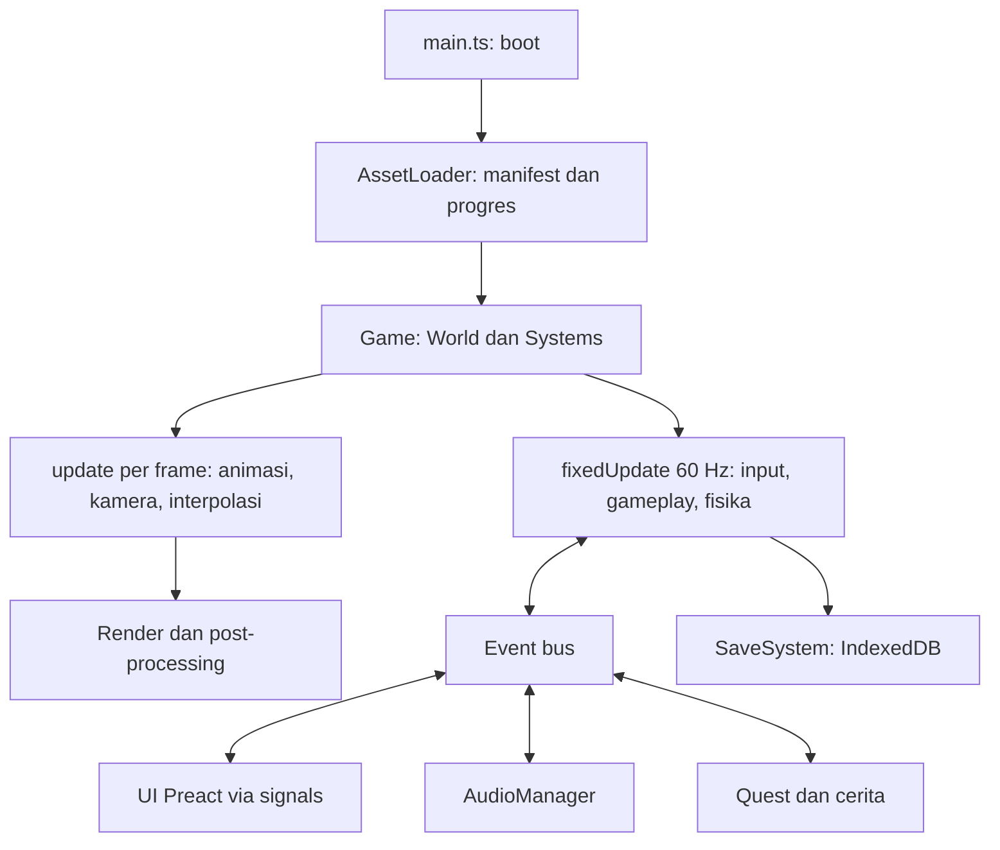
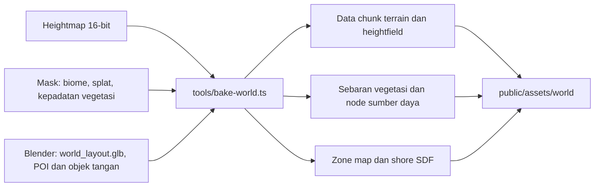

# 03 · Technical Design

| | |
|---|---|
| Versi | 0.1 (draft untuk review) |
| Engine | three.js r186 (`WebGLRenderer`, WebGL2) |
| Dokumen terkait | [Game Design Document](01-game-design-document.md) · [Konten & Balancing](02-content-and-balancing.md) · [Asset Pipeline](05-asset-pipeline.md) |

Dokumen ini menjelaskan **bagaimana** game dibangun: teknologi, arsitektur, dan teknik rendering untuk mencapai tampilan cozy (air bening, daun bergoyang, langit cerah), plus aturan main supaya kode tetap rapi dan cepat.

---

## 1. Target Teknis

| Target | Nilai |
|---|---|
| FPS | 60 FPS @1080p dengan preset *Sedang* di laptop kelas menengah (Intel Iris Xe, AMD Radeon 680M, Apple M1). ≥ 30 FPS dengan preset *Rendah* di iGPU lama |
| Waktu muat | Bisa mulai bermain < 15 dtk pada koneksi 50 Mbps |
| Unduhan awal | ≤ 60 MB; sisanya dimuat di latar belakang (total ≤ 200 MB) |
| Browser | Dua versi terakhir Chrome, Edge, Firefox, dan Safari desktop. Wajib WebGL2 |
| Input | Keyboard + mouse (Pointer Lock API); gamepad menyusul |
| Memori | Tab ≤ 1,5 GB RAM; tekstur di VRAM ≤ 512 MB (preset *Sedang*) |
| Penyimpanan | Lokal di browser (IndexedDB), dengan ekspor/impor file save |

---

## 2. Tech Stack

Versi per Oktober 2026. Saat setup, versi dipatok persis di `package.json` dan diperbarui secara sadar, bukan otomatis.

| Area | Pilihan | Versi | Catatan |
|---|---|---|---|
| Bahasa | TypeScript, mode `strict` | 7.0.x | |
| Build & dev server | Vite | 8.x | HMR, bundling aset |
| Rendering | three.js | r186 (`0.186.x`) | `WebGLRenderer`; addon `Sky`, `CSM`, `GLTFLoader`, `KTX2Loader` |
| Post-processing | `postprocessing` (pmndrs) | 6.39.x | Mendukung three ≥ 0.168 dan < 0.187 |
| Fisika | `@dimforge/rapier3d-compat` | 0.21.x | WASM; `KinematicCharacterController`, collider heightfield |
| UI | Preact + `@preact/signals` | 11.x / 2.x | Overlay DOM di atas canvas |
| Save | `idb-keyval` | 6.x | IndexedDB |
| Noise | `simplex-noise` | 4.x | Detail terrain, angin, variasi |
| Raycast cepat (opsional) | `three-mesh-bvh` | 0.9.x | Raycast interaksi pada mesh rumit |
| Navigasi AI (opsional) | `@recast-navigation/three` | 0.43.x | Hanya jika steering sederhana tidak cukup |
| Debug (khusus dev) | `lil-gui`, `stats-gl` | 0.21 / 4.x | |
| Tes | Vitest, Playwright | 5.x / 1.64.x | |
| Lint & format | ESLint (flat config) + `typescript-eslint`, Prettier | | |
| Optimasi aset | `@gltf-transform/cli` | 4.5.x | Butuh KTX-Software (`toktx`) untuk KTX2 |
| Hosting | Vercel (preview per branch), itch.io untuk rilis | | |

---

## 3. Keputusan Arsitektur (ADR)

### ADR-001: `WebGLRenderer`, belum `WebGPURenderer`
- **Konteks.** WebGPU sudah tersedia luas (Chrome/Edge, Safari 26, Firefox 141 di Windows), dan three.js mengarah ke `WebGPURenderer` + TSL. Tapi laporan komunitas sepanjang 2025–2026 menunjukkan `WebGLRenderer` masih lebih cepat untuk scene dengan banyak mesh dan untuk frame pertama, dan ekosistem post-processing pmndrs hanya mendukung WebGL.
- **Keputusan.** Pakai `WebGLRenderer` (WebGL2) dengan shader GLSL (`ShaderMaterial` dan `onBeforeCompile`).
- **Konsekuensi.** Shader custom ditulis sebagai chunk modular di `src/shaders/` supaya bisa diport ke TSL. Keputusan ini dievaluasi ulang setelah vertical slice.

### ADR-002: three.js imperatif, bukan React Three Fiber
- **Alasan.** Game loop dan puluhan sistem per-frame lebih mudah dikontrol secara imperatif, tanpa overhead *reconciliation*. React-style hanya dipakai untuk UI (Preact).

### ADR-003: Rapier untuk fisika dan character controller
- **Alasan.** WASM yang cepat, punya `KinematicCharacterController` (naik tangga dan lereng, menempel ke tanah), collider heightfield untuk terrain, serta query shape-cast untuk kamera dan validasi bangunan.

### ADR-004: Entity–Component ringan buatan sendiri
- **Konteks.** Miniplex tidak aktif sejak 2023, sedangkan Koota masih versi 0.x.
- **Keputusan.** Buat World sederhana (±150 baris) bergaya miniplex: entitas berupa objek data polos dengan komponen opsional, plus query yang di-cache.
- **Alasan.** Entitas dinamis hanya ratusan, dan objek data polos mudah diserialisasi untuk save. Objek statis massal (pohon, batu, rumput) **bukan** entitas (lihat §7.2).

### ADR-005: Konten data-driven di TypeScript
- **Keputusan.** Item, resep, ikan, dan konten lain didefinisikan di `src/data/*.ts` dengan `as const satisfies`, sehingga salah ketik ID tertangkap saat compile. Unit test memvalidasi referensi silang.
- **Konsekuensi.** Bisa dipindah ke JSON kelak bila perlu modding.

### ADR-006: UI berupa overlay DOM (Preact), bukan UI di canvas
- **Alasan.** Teks tajam, aksesibilitas, layout fleksibel, dan cepat dikembangkan. HUD yang sering berubah di-throttle agar tidak membebani frame.

### ADR-007: Format aset glTF Binary + KTX2 + Meshopt
- **Alasan.** Standar web, dimuat langsung oleh `GLTFLoader`. KTX2 (Basis Universal) memangkas VRAM dan waktu upload tekstur; Meshopt memperkecil geometri dan animasi.

### ADR-008: Simulasi fixed timestep 60 Hz, render variabel
- **Alasan.** Fisika dan logika deterministik serta stabil di monitor 60 Hz maupun 144 Hz. Transform visual diinterpolasi supaya gerakan tetap halus.

---

## 4. Struktur Folder

```
src/
├── main.ts                 # boot: renderer, loader, game
├── core/                   # game loop, World (ECS), event bus, input, waktu, RNG, save, asset loader
├── render/                 # renderer, post-processing, preset kualitas, render layer
├── world/
│   ├── terrain/            # chunk heightmap, material splat, collider heightfield
│   ├── water/              # gelombang (CPU + GPU), material laut, bawah air, kaustik
│   ├── sky/                # kubah langit, awan, matahari & bulan, color script
│   ├── vegetation/         # instancing, LOD, rumput, angin
│   ├── weather/            # cuaca, hujan, badai, angin global
│   └── nodes/              # registry node sumber daya (pohon, batu, semak) + spatial hash
├── player/                 # controller (Rapier KCC), state machine gerak, renang, rig kamera, animasi, interaksi
├── gameplay/
│   ├── survival/           # stat, status, pingsan
│   ├── inventory/          # slot, tumpukan, tas, wadah air
│   ├── crafting/           # resep, stasiun, memasak, bahan bakar
│   ├── building/           # mode bangun, snapping, validasi, kenyamanan
│   ├── farming/            # petak, pertumbuhan, penyiraman
│   ├── fishing/            # lempar, gigitan, minigame, tabel ikan
│   ├── hunting/            # AI hewan, spawn, senjata, jerat & bubu
│   └── story/              # quest, Harapan, event terjadwal, jurnal, dialog radio
├── audio/                  # AudioManager, bus, ambience, musik
├── ui/                     # komponen Preact: HUD, tas, racik, jurnal, menu, pengaturan
├── data/                   # items, recipes, plants, crops, fish, animals, buildables, loot, quests, balance
├── shaders/                # chunk GLSL: waves, water, foliage-wind, terrain-splat, caustics, sky
├── i18n/                   # id.json, en.json
└── debug/                  # panel lil-gui, cheat, overlay performa (khusus dev)
public/
├── assets/                 # models/, textures/, audio/, ui/, world/ (hasil optimasi)
└── libs/basis/             # transcoder KTX2
tools/                      # bake-world.ts, optimize-assets.ts, build-manifest.ts, icon-atlas.ts
tests/
├── unit/                   # Vitest
└── e2e/                    # Playwright
art/                        # style bible, template prompt, catatan asal-usul aset
docs/
```

Logika gameplay murni (inventaris, resep, pertumbuhan tanaman, tabel ikan, rumus stat) **tidak boleh meng-import three.js**, supaya bisa dites cepat dengan Vitest.

---

## 5. Arsitektur Runtime



### 5.1 Urutan Sistem

| # | Sistem | Frekuensi | Tugas |
|---|---|---|---|
| 1 | Input | Fixed | Membaca keyboard/mouse/gamepad → aksi abstrak (`move`, `interact`, `useTool`, ...) |
| 2 | Time | Fixed | Menambah menit game, memicu event `time:hour` dan `time:day` |
| 3 | Weather & Wind | Fixed | Transisi cuaca, kekuatan dan arah angin global |
| 4 | PlayerController | Fixed | State machine gerak → `KinematicCharacterController` |
| 5 | Swim | Fixed | Status di air, daya apung, oksigen |
| 6 | AnimalAI | Fixed (LOD: 5–20 Hz) | FSM dan steering hewan |
| 7 | Physics | Fixed | `world.step()` Rapier |
| 8 | Interaction | Fixed | Mencari target interaksi terdekat |
| 9 | ToolAction | Fixed | Ayunan, hit, panen, tangkapan |
| 10 | Survival | Fixed | Laju stat dan status |
| 11 | Farming & Growth | Saat `time:hour` | Pertumbuhan tanaman, node tumbuh kembali, basi |
| 12 | Crafting & Stations | Fixed | Timer racik dan masak, bahan bakar |
| 13 | Building | Fixed (saat mode bangun) | Posisi ghost, snapping, validasi |
| 14 | Spawn | Saat `time:hour` | Barang hanyut, hewan muncul kembali |
| 15 | Story | Berbasis event | Kondisi quest, Harapan, event terjadwal |
| 16 | Animation | Per frame | `AnimationMixer` dan event animasi |
| 17 | Camera | Per frame | Rig TPV/FPV, tabrakan, smoothing |
| 18 | RenderSync | Per frame | Interpolasi transform, matrix instance, uniform (waktu, angin, matahari) |
| 19 | Vegetation | Per frame (throttle) | Chunk rumput di sekitar pemain, pengelompokan LOD |
| 20 | Water | Per frame | Uniform gelombang, deteksi kamera di bawah air |
| 21 | Audio | Per frame | Posisi listener, mix ambience |
| 22 | Render | Per frame | Scene + post-processing |
| 23 | UI | ≤ 10 Hz untuk nilai non-kritis | Signals diperbarui dari state game |

---

## 6. Game Loop & Waktu

```ts
import { Timer } from 'three'; // THREE.Clock sudah deprecated sejak r183

const FIXED_DT = 1 / 60;
const MAX_FRAME_DT = 0.25; // cegah "spiral of death" setelah tab tidak aktif

const timer = new Timer();
timer.connect(document); // memakai Page Visibility API agar delta tidak melonjak
let accumulator = 0;

renderer.setAnimationLoop((timestamp) => {
  timer.update(timestamp);
  const frameDt = Math.min(timer.getDelta(), MAX_FRAME_DT);
  accumulator += frameDt;

  while (accumulator >= FIXED_DT) {
    game.fixedUpdate(FIXED_DT); // input, gameplay, fisika, waktu game
    accumulator -= FIXED_DT;
  }

  game.update(frameDt, accumulator / FIXED_DT); // alpha untuk interpolasi visual
  game.render();
});
```

**Waktu game** disimpan sebagai satu angka absolut, `gameMinutes` (menit sejak awal permainan). Semua timer (tanaman ditanam, makanan basi, node tumbuh kembali, bahan bakar habis) disimpan sebagai **timestamp absolut** dalam menit game, bukan penghitung yang dikurangi per frame. Akibatnya:
- **Tidur atau lompat waktu menjadi sepele.** Cukup panggil `skipTo(targetMinutes)`, lalu hitung perubahan stat secara analitis dan biarkan setiap sistem membaca waktu baru.
- **Save file kecil dan stabil**, karena tidak ada state "sisa detik" yang harus disimpan.

---

## 7. Model Data

### 7.1 Entity & World

```ts
// src/core/ecs.ts — entitas = objek data polos; komponen = properti opsional
export interface Entity {
  id: number;
  transform?: { position: Vector3; rotation: Quaternion };
  model?: { assetId: AssetId; object?: Object3D }; // object tidak ikut disimpan
  body?: { handle: number };                         // handle rigid body Rapier
  health?: { hp: number; max: number };
  interactable?: { action: InteractAction; labelKey: string };
  inventory?: { slots: Slot[] };
  crop?: { cropId: CropId; plantedAt: number; lastWateredAt: number };
  animal?: { speciesId: AnimalId; state: AnimalState; homeZone: ZoneId };
  buildPiece?: { pieceId: BuildPieceId; hp: number };
  station?: { stationId: StationId; fuelUntil?: number; jobs: CraftJob[] };
  persistent?: true; // ikut disimpan ke save file
}

const world = new World<Entity>();
const crops = world.with('crop', 'transform'); // query di-cache, diperbarui otomatis
for (const e of crops) {
  // ...
}
```

### 7.2 Objek Statis Massal
Pohon, batu, semak, dan rumput berjumlah ribuan, jadi **tidak** dijadikan entitas:
- **`ResourceNodeRegistry`** menyimpan data node (ID stabil, jenis, posisi, rotasi, skala) hasil bake dunia, ditambah *delta* status: ditebang kapan, tumbuh kembali kapan.
- **Spatial hash** (sel 16 m) dipakai untuk query cepat: node terdekat untuk interaksi, collider di sekitar pemain, dan validasi bangunan.
- **Rendering** memakai `InstancedMesh` per spesies dan per LOD. Node yang ditebang disembunyikan dengan menukar instance-nya ke akhir buffer dan mengurangi `count`.
- **Save** hanya menyimpan delta (misalnya `{ "tree_0412": { cutAt: 5320 } }`), bukan seluruh dunia.

### 7.3 Definisi Konten

```ts
// src/data/items.ts
export const ITEMS = {
  coconut: {
    category: 'food',
    stack: 10,
    spoilHours: 144,
    food: { hunger: 3, thirst: 25 },
    onConsume: [
      { item: 'coconut_meat', qty: 1 },
      { item: 'coconut_shell', qty: 2 },
      { item: 'coconut_husk', qty: 1 },
    ],
  },
  stone_axe: {
    category: 'tool',
    stack: 1,
    durability: 120,
    tool: { kind: 'axe', damage: 12, staminaCost: 6 },
  },
} as const satisfies Record<string, ItemDef>;

export type ItemId = keyof typeof ITEMS;
```

```ts
// src/data/recipes.ts
export const RECIPES = [
  {
    id: 'stone_axe',
    station: 'hand',
    inputs: [{ item: 'stick', qty: 2 }, { item: 'stone', qty: 2 }, { item: 'rope', qty: 1 }],
    output: { item: 'stone_axe', qty: 1 },
    seconds: 4,
    unlock: { onHold: ['stick', 'stone'] },
  },
] as const satisfies readonly RecipeDef[];
```

Unit test data memastikan setiap ID yang dirujuk (di resep, loot, quest, `onConsume`) benar-benar ada, dan setiap ID punya teks i18n di `id.json` dan `en.json`.

### 7.4 Event Bus

```ts
// src/core/events.ts
export interface GameEvents {
  'item:gained': { itemId: ItemId; qty: number; source: 'pickup' | 'craft' | 'loot' | 'harvest' };
  'stat:low': { stat: SurvivalStat };
  'time:hour': { day: number; hour: number };
  'weather:changed': { from: WeatherKind; to: WeatherKind };
  'build:placed': { pieceId: BuildPieceId };
  'quest:completed': { questId: QuestId };
  'harapan:changed': { value: number; delta: number };
}

export const events = new EventBus<GameEvents>(); // on / off / emit dengan tipe ketat
```

Sistem tidak saling memanggil langsung untuk hal lintas-domain. Contohnya, Story mendengarkan `build:placed` untuk quest rumah, dan Audio mendengarkan `item:gained` untuk bunyi pungut.

### 7.5 Angka Acak
RNG memakai generator ber-seed (mis. `sfc32`), dengan stream terpisah untuk loot, ikan, spawn, dan cuaca. Hasilnya bisa direproduksi di unit test dan saat men-debug laporan bug.

---

## 8. Rendering

### 8.1 Renderer & Warna
- `new WebGLRenderer({ powerPreference: 'high-performance', antialias: false, stencil: false, depth: false })`. Konfigurasi ini sesuai rekomendasi pmndrs `postprocessing`, karena composer punya buffer sendiri. Anti-aliasing memakai SMAA di post-processing.
- `renderer.outputColorSpace = SRGBColorSpace`. Tekstur warna (albedo) memakai sRGB; normal, ORM, dan data lain memakai linear. `GLTFLoader` sudah mengatur ini otomatis.
- **Tone mapping** dilakukan di composer (`ToneMappingEffect`), dan `renderer.toneMapping = NoToneMapping`. Awalnya dipakai **Neutral** (warna tekstur tetap setia pada palet), lalu mood diatur lewat LUT color grading. ACES dan AgX bisa dibandingkan lewat panel debug.
- **Pixel ratio:** `min(devicePixelRatio, 1.5)`, ditambah *dynamic resolution* (skala 0,6–1,0) yang menyesuaikan dengan frame time.

### 8.2 Pencahayaan & Bayangan
- **`DirectionalLight`** untuk matahari atau bulan, ditambah **`HemisphereLight`** dengan warna langit dan tanah dari *color script* (lihat Art Direction). Bayangan menjadi kebiruan, tidak hitam.
- **Environment map** resolusi rendah dibuat dari kubah langit dengan `PMREMGenerator`, diperbarui tiap ±10 menit game atau saat cuaca berganti. Dipakai untuk pantulan di air dan permukaan basah.
- **Bayangan:** `PCFShadowMap` (`PCFSoftShadowMap` sudah deprecated di r186). Kamera bayangan mengikuti pemain dengan cakupan 50–80 m dan *texel snapping* agar tidak berkedip. Preset *Tinggi* memakai addon `CSM` dengan 3 cascade.
- **Yang menghasilkan bayangan:** pohon, batu, bangunan, karakter, dan hewan. Rumput dan partikel tidak.

### 8.3 Langit & Atmosfer
- **Kubah langit custom** (shader): gradien zenit ke horizon sesuai posisi matahari, piringan dan halo matahari, bulan, serta bintang di malam hari. Semua parameter berasal dari *color script* yang di-*keyframe* per jam.
- **Awan:** 1–2 lapisan noise prosedural di kubah, bergerak pelan mengikuti angin, ditambah beberapa billboard awan kumulus besar di horizon. Tutupan awan diatur oleh cuaca.
- **Kabut:** warnanya disamakan dengan warna horizon agar laut menyatu mulus dengan langit. Di bawah air, warna dan kepadatan kabut diganti.
- **Graybox:** addon `Sky` (model Preetham) cukup untuk Fase 1 sebelum shader custom selesai.

### 8.4 Air Laut
Air adalah fitur visual terpenting. Teknik yang dipakai:

**Geometri & gelombang**
- Grid laut mengikuti kamera dan di-*snap* ke grid supaya pola tidak "berenang". Grid padat di dekat kamera dan renggang di jauh, ditambah bidang sederhana sampai horizon.
- 4–6 **gelombang Gerstner** dihitung di vertex shader. Amplitudonya lembut (0,05–0,3 m saat tenang) dan membesar saat badai.
- **Fungsi gelombang yang sama di CPU** (`sampleWaterHeight`) dipakai untuk renang, pelampung, barang yang mengapung, perahu di prolog, dan deteksi kamera bawah air. Parameter gelombang hanya punya satu sumber dan di-upload sebagai uniform.

```ts
// src/world/water/waves.ts — dipakai CPU dan di-upload ke shader
export interface GerstnerWave { dirX: number; dirZ: number; steepness: number; wavelength: number }

/** Tinggi permukaan air di (x, z). Gerstner juga menggeser titik secara horizontal,
 *  jadi dicari dulu titik asal yang tergeser ke (x, z) dengan 2 iterasi. */
export function sampleWaterHeight(waves: readonly GerstnerWave[], x: number, z: number, t: number): number {
  let px = x;
  let pz = z;
  for (let i = 0; i < 2; i++) {
    gerstnerOffset(waves, px, pz, t, tmp); // tmp = objek {dx, dy, dz} yang di-reuse (tanpa alokasi)
    px = x - tmp.dx;
    pz = z - tmp.dz;
  }
  gerstnerOffset(waves, px, pz, t, tmp);
  return SEA_LEVEL + tmp.dy;
}
```

**Shading** (pass terpisah agar tidak me-render scene dua kali)
1. Render objek opaque ke `opaqueTarget` (warna + `DepthTexture`).
2. Render air di atasnya dengan sampel dari `opaqueTarget`:
   - **Warna berdasarkan kedalaman:** selisih kedalaman permukaan air dengan dasar → gradasi toska dangkal → biru tua (palet di Art Direction). Inilah yang membuat air terasa **bening**: dasar pasir terlihat jelas di laguna.
   - **Refraksi:** UV `opaqueTarget` digeser oleh normal air sehingga dasar laut tampak beriak.
   - **Pantulan:** fresnel memadukan environment map langit, ditambah kilau matahari (*specular glints*).
   - **Buih tepi pantai:** muncul di area dengan selisih kedalaman kecil, ditambah garis buih bergaya yang bergerak ke arah pantai memakai *shore SDF* (peta jarak ke garis pantai hasil bake). Buih juga muncul di puncak gelombang.
   - **Subsurface palsu:** puncak gelombang yang membelakangi matahari diberi warna toska terang.
3. **Kaustik:** shader terrain dan batu disisipi (`onBeforeCompile`) pola kaustik animasi, berupa dua sampel tekstur bergerak yang digabung dengan `min`. Pola hanya muncul di bawah permukaan air dan memudar sesuai kedalaman dan intensitas matahari.
4. **Pasir basah:** shader terrain menggelapkan pasir di pita garis air, mengikuti naik-turunnya gelombang.
5. **Plankton bercahaya (malam):** bintik emisif cyan di area buih, ditangkap oleh bloom.

**Bawah air**
- Kamera dianggap di bawah air bila `camera.y < sampleWaterHeight(...) − 0,03`, dan dianggap keluar bila `> +0,03` (histeresis agar tidak berkedip).
- Saat di bawah air: efek post (warna toska, kabut, vinyet halus, sedikit distorsi), *god rays*, partikel melayang, dan permukaan air dilihat dari bawah memakai shader *backside*. Audio diredam dengan low-pass (§16).
- Tanpa kacamata selam: blur tambahan dan jarak pandang pendek.

**Kualitas:** preset *Rendah* tanpa refraksi dan tanpa kaustik; *Sedang* memakai refraksi ½ resolusi; *Tinggi* memakai resolusi penuh dan 6 gelombang.

### 8.5 Terrain
- **Heightmap 16-bit 1025×1025** (1 m per piksel) dipotong menjadi chunk 64×64 m dengan 3 level LOD (jarak titik 1, 2, dan 4 m) plus *skirt* untuk menutup celah. Setiap chunk di-*frustum cull*.
- **Material splat** custom dengan 2 splatmap RGBA (8 layer: pasir kering, pasir basah, rumput, tanah, batu, tebing, lumpur, karang). Lereng curam memakai *triplanar* untuk batu, ditambah *detail normal* dan variasi warna dari noise.
- **Collider:** heightfield Rapier dari data yang sama (boleh resolusi 513² agar ringan). Perhatikan urutan data heightfield Rapier yang *column-major*.

### 8.6 Vegetasi & Angin
- **`WindSystem` global:** arah, kekuatan (dari cuaca), dan fungsi hembusan (noise frekuensi rendah yang bergerak searah angin). Uniform yang sama dipakai oleh vegetasi, kain (sarung, bendera), partikel daun, dan kemiringan hujan.
- **Goyangan di vertex shader** memakai **vertex color** yang di-*bake* di Blender: **R** = besar ayunan batang (0 di pangkal, 1 di ujung), **G** = getar daun, **B** = fase acak per cabang. Ditambah offset berbasis posisi dunia supaya tidak ada dua pohon yang bergerak serempak. Hembusan angin terlihat sebagai "gelombang" yang menyapu padang rumput.
- **Pohon & semak:** satu `InstancedMesh` per spesies per LOD. Instance dikelompokkan ulang ke LOD0/LOD1 setiap kali pemain bergerak > 10 m (murah di CPU).
- **Rumput:** `InstancedMesh` per chunk 16 m dalam radius 25–80 m di sekitar pemain (tergantung preset). Kepadatan diambil dari splatmap rumput; warna mengikuti warna terrain di bawahnya plus noise; rumput melengkung menjauhi pemain (uniform `uPlayerPos`); memudar di batas radius. Rumput tidak menghasilkan bayangan.
- **Daun:** `alphaTest` (dengan `alphaToCoverage` bila MSAA aktif), dua sisi. Ada efek tembus cahaya palsu: daun yang membelakangi matahari diberi warna hijau-kuning terang. Normal kartu daun dibuat bulat (*spherical normals*) di Blender agar pencahayaan semak lembut.
- **Pohon ditebang:** instance disembunyikan, mesh batang jatuh sebagai rigid body Rapier sementara, lalu diganti instance tunggul. Status disimpan di registry (§7.2).

### 8.7 Karakter & Material Umum
- Material dari glTF memakai `MeshStandardMaterial` (stylized PBR). Karakter mendapat **rim light lembut** (fresnel, lewat `onBeforeCompile`) agar menonjol dari latar.
- Objek yang bisa diinteraksi mendapat *highlight* tepi saat dibidik (uniform emisif fresnel, lebih murah dari outline pass).

### 8.8 Post-processing
Memakai `EffectComposer` dari pmndrs `postprocessing` dengan `frameBufferType: HalfFloatType` (HDR):
1. `RenderPass` (atau pass custom opaque + air, §8.4)
2. `EffectPass`: Bloom (threshold tinggi, lembut) → efek bawah air (custom) → ToneMapping (Neutral) → LUT color grading (dua LUT dicampur sesuai jam) → vinyet halus
3. `EffectPass`: SMAA (dipisah karena efek konvolusi)

Opsional di preset *Tinggi*: ambient occlusion layar (SSAO) dengan intensitas rendah.

### 8.9 Partikel & VFX
Sistem partikel GPU sederhana (`InstancedMesh` atau `Points` dengan atribut per partikel) dan pool tetap tanpa alokasi saat jalan. Efek yang dibutuhkan: debu pasir, serpihan kayu, daun berguguran, cipratan dan riak air, gelembung, api dan asap, hujan (garis di sekitar kamera), riak di genangan, kunang-kunang, kupu-kupu, semburan ombak di batu, dan pelangi.

### 8.10 Preset Kualitas

| Setelan | Rendah | Sedang | Tinggi | Ultra |
|---|---|---|---|---|
| Skala resolusi | 0,75 (dinamis) | 1,0 (dinamis) | 1,0 | 1,0, pixel ratio ≤ 2 |
| Bayangan | 1024 px, 50 m | 2048 px, 80 m | CSM 3 cascade, 2048 px | CSM 3 cascade, 4096 px |
| Radius rumput | 25 m, jarang | 45 m | 60 m | 80 m, padat |
| Jarak LOD0 vegetasi | 25 m | 40 m | 60 m | 80 m |
| Air: refraksi | Tidak | ½ resolusi | Penuh | Penuh |
| Air: kaustik | Tidak | Ya | Ya | Ya |
| Jumlah gelombang | 3 | 4 | 6 | 6 |
| Bloom | Tidak | Ya | Ya | Ya |
| SSAO | Tidak | Tidak | Ya | Ya |
| Anisotropi | 2 | 4 | 8 | 16 |
| Partikel | 50% | 100% | 100% | 150% |

Preset awal dipilih otomatis dari benchmark singkat saat pertama kali dibuka, dan bisa diubah di pengaturan.

---

## 9. Kamera TPV & FPV

`CameraRig` punya mode: `thirdPerson`, `firstPerson`, `aim`, `build`, `cinematic`, dan `photo` (nanti).

**TPV**
- Pivot di kepala pemain (±1,6 m) dengan offset bahu 0,4 m (kanan, bisa ditukar). Yaw dan pitch dari mouse; pitch dibatasi −70° sampai +70°.
- Posisi kamera = pivot − arah pandang × jarak (1,5–7 m, scroll untuk zoom).
- **Tabrakan:** `castShape` bola (r = 0,25 m) di Rapier dari pivot ke posisi kamera yang diinginkan. Bila mengenai sesuatu, kamera maju ke titik kena − 0,1 m. Kamera maju cepat (λ = 20) dan mundur pelan (λ = 4) agar tidak meloncat-loncat. Collider kecil (rumput, item) diabaikan lewat collision group.
- **Smoothing** memakai *exponential damping* yang tidak bergantung frame rate: `x = lerp(x, target, 1 − exp(−λ · dt))`.
- **Arah karakter:** saat menjelajah, karakter menghadap arah gerak relatif kamera (putaran 720°/dtk). Dalam mode `aim` (busur, lempar tombak, lempar kail), karakter mengikuti yaw kamera dan kamera pindah ke atas bahu dengan FOV sedikit lebih sempit.

**FPV**
- Kamera menempel di tulang kepala dengan offset mata; `near = 0,05`; pitch −85° sampai +85°.
- **Versi awal: badan penuh.** Mesh kepala dan rambut (dipisah di Blender, lihat Asset Pipeline) disembunyikan dari kamera utama lewat layer, tapi tetap menghasilkan bayangan. Badan, tangan, dan alat terlihat dari animasi yang sama, sehingga tidak perlu set animasi kedua.
- **Opsi lanjutan:** *viewmodel* lengan + alat di scene terpisah, dirender setelah pass utama dengan depth dibersihkan dan FOV sendiri, supaya alat tidak pernah menembus dinding. Dievaluasi setelah vertical slice.
- Head bob ringan (amplitudo 0,03 m, bisa dimatikan) berdasarkan jarak tempuh.

**Transisi & lain-lain**
- Tombol **V**, atau scroll ke dalam sampai mentok, memicu transisi jarak ke 0 dalam 0,25 dtk. Pada jarak < 0,6 m, badan memudar dengan *dither* sebelum beralih ke FPV.
- Pointer Lock dengan `unadjustedMovement: true` bila didukung, untuk input mouse mentah.
- **Cinematic:** jalur `CatmullRomCurve3` dengan target pandang dan letterbox untuk cutscene.
- **Bawah air:** pemeriksaan histeresis (§8.4) dilakukan pada posisi kamera akhir.

---

## 10. Karakter, Fisika & Animasi

**Rapier**
- Gravitasi −9,81; `integrationParameters.dt = 1/60`.
- **Pemain:** kapsul (radius 0,3 m, half-height 0,6 m, total ±1,8 m) dengan `KinematicCharacterController`:
  - `world.createCharacterController(0.02)`
  - `enableAutostep(0.35, 0.2, true)` dan `enableSnapToGround(0.3)`
  - `setMaxSlopeClimbAngle(45°)` dan `setMinSlopeSlideAngle(50°)`
  - `setApplyImpulsesToDynamicBodies(true)`
- **Collision group:** `PLAYER`, `TERRAIN`, `STATIC` (batu, batang pohon, bangunan), `DYNAMIC` (kayu jatuh, item), `ANIMAL`, `SENSOR`, `CAMERA_BLOCKER`.
- **Collider statis:** batang pohon memakai kapsul/silinder dari transform instance; batu memakai convex hull (dihitung saat bake); bagian bangunan memakai kotak. Collider untuk node yang jauh tidak dibuat; collider dibuat dan dihapus mengikuti spatial hash di sekitar pemain.

**State machine gerak:** `Idle`, `Walk`, `Run`, `Crouch`, `Jump`, `Fall`, `Land`, `Wade`, `Swim`, `Dive`, `Float` (stamina habis), `Climb` (memanjat pohon kelapa, berbasis animasi), `Action` (memakai alat, gerak terkunci), `Sit`, `Sleep`, `Faint`.

**Air & renang**
- Air bukan body fisika. Kedalaman dihitung dari `sampleWaterHeight` dikurangi tinggi terrain di posisi pemain. Kedalaman 0,5–1,1 m: `Wade` (lambat). Lebih dari 1,1 m: `Swim`.
- Saat berenang: gravitasi KCC dimatikan, daya apung menahan kepala di permukaan (posisi target mengikuti gelombang), dan ada drag. Saat menyelam, gerak 3D mengikuti arah kamera.
- Benda mengapung (kelapa, kayu apung, pelampung) memakai pegas sederhana ke ketinggian gelombang.

**Animasi**
- Satu `AnimationMixer` per karakter. Gerak dasar memakai *blend* idle/jalan/lari berdasarkan kecepatan; aksi memakai `crossFadeTo` (0,15–0,25 dtk). Semua animasi *in-place* (tanpa root motion).
- **Event animasi** didefinisikan sebagai data, misalnya `{ clip: 'chop', events: [{ t: 0.42, name: 'hit' }] }`, karena three.js tidak punya event animasi bawaan. Event `hit` inilah yang memicu kerusakan, suara, dan partikel tepat saat kapak mengenai pohon.
- *Foot IK* sederhana di lereng masuk kategori *Could*.

---

## 11. Interaksi & Alat
- **Mencari target:** di FPV memakai ray dari tengah layar (maks 2,5 m dari pemain). Di TPV memakai query bola di sekitar pemain (r = 2,5 m), lalu dipilih target dengan skor terbaik dari sudut terhadap arah kamera dan jarak.
- Target terpilih mendapat *highlight* dan prompt (`[E] Ambil kelapa`). Interaksi tahan (memanjat, Periksa) menampilkan cincin progres.
- **Pasangan alat–aksi** didefinisikan di data: kapak → tebang, beliung → pecah batu, pisau → potong/panen/kuliti, joran → mancing, tombak → serang/tombak ikan, cangkul → mencangkul/menggali, penyiram → siram, palu → bangun/perbaiki.

---

## 12. Catatan Implementasi Sistem Gameplay
- **Inventaris:** fungsi murni (`add`, `remove`, `move`, `split`, `merge`) atas array slot `{ itemId, qty, durability?, freshness?, liquid? }`. Wajib di-unit test.
- **Racik:** pencocokan bahan per item atau per tag (misalnya "kayu apa saja"). Stasiun valid bila berjarak ≤ 3 m. Bahan boleh diambil dari peti dalam radius 8 m. Ada progres waktu racik.
- **Survival:** laju per jam game dari `balance.ts`, dikalikan `Δmenit / 60` setiap tick. Status berupa data (durasi, modifier, penyembuh).
- **Berkebun:** tahap tanaman dihitung dari `plantedAt`, `lastWateredAt`, dan waktu sekarang, tidak disimpan per tick. Hujan memperbarui `lastWateredAt` semua petak tanpa atap.
- **Memancing:** pemilihan ikan memakai tabel berbobot yang disaring zona, jam, dan cuaca. Logika minigame berupa TypeScript murni (bisa dites) dengan RNG ber-seed. Zona air di titik pelampung diambil dari *zone map* hasil bake dan kedalaman.
- **Story:** quest berupa data. Setiap langkah punya kondisi bertipe, misalnya `{ type: 'craft', item: 'campfire' }`, `{ type: 'enterArea', area: 'spring' }`, `{ type: 'have', item: 'boat_battery' }`, atau `{ type: 'time', day: 5, hour: 16 }`. Kondisi diperiksa saat event relevan muncul, bukan setiap frame.

---

## 13. AI Hewan
- **FSM per spesies** yang parameternya didefinisikan di data:
  - Kepiting: `Wander ↔ Flee → Hide`
  - Ayam hutan: `Idle/Peck → Wander → Flee (lari + terbang pendek)`
  - Babi hutan: `Idle → Wander → Alert → Charge → Recover` (atau `Flee` saat HP rendah)
- **Steering:** seek, flee, wander, dan penghindaran rintangan dengan 3 raycast pendek. Tinggi diambil dari heightmap. Hewan dibatasi di zona asalnya (*biome map*).
- **Deteksi:** radius sadar dikalikan faktor jongkok (×0,5) dan faktor lari (×1,5).
- **LOD AI:** < 30 m = 20 Hz dengan animasi penuh; 30–80 m = 5 Hz; > 80 m = dibekukan atau di-*despawn*.
- **Spawn:** batas populasi per zona. Hewan muncul kembali di luar pandangan kamera pada malam hari, sesuai timer di Konten & Balancing.
- Ikan hias dan kawanan ikan memakai animasi vertex shader dan *boids* sederhana di GPU/CPU, tanpa skeleton.

---

## 14. Sistem Bangunan
- **Definisi bagian** (data): `id`, `tier`, biaya, ukuran, collider, model, dan daftar **soket** (titik snap dengan tipe, misalnya `floor_edge`, `wall_top`, `pillar_top`).
- **Penempatan:** ray dari kamera → posisi kandidat. Sistem mencari soket kompatibel terdekat dalam 1 m (memakai spatial hash soket); bila tidak ada, posisi di-*snap* ke grid 2 m dengan langkah tinggi 0,5 m. Struktur diputar per 90°, perabot per 15°.
- **Validasi:**
  - Tidak tumpang tindih: `intersectionsWithShape` Rapier dengan kotak yang sedikit diperkecil.
  - Ada penopang: harus terhubung ke tiang/fondasi yang menyentuh tanah atau dasar air ≤ 1,5 m.
  - Lereng tanah untuk fondasi ≤ 25°.
  - Bahan tersedia (tas + peti dalam radius 8 m).
- **Ghost preview:** material transparan hijau/merah dan tooltip alasan bila tidak valid.
- **Rendering:** `InstancedMesh` per jenis bagian (satu draw call per jenis). Semua bagian tier yang sama memakai satu *trim sheet* bersama.
- **Kenyamanan:** dihitung ulang saat ada perabot dipasang/dibongkar di sekitar tempat tidur, memakai aturan di Konten & Balancing §4.6.
- **Save:** daftar `{ pieceId, position, rotation, hp }`.

---

## 15. Pembuatan Dunia (World Authoring)



1. **Heightmap** 1025² 16-bit, dibuat di Gaea (gratis) atau dilukis di Krita (lihat Asset Pipeline). Disertai **mask**: biome/zona, splatmap terrain, dan kepadatan per jenis vegetasi.
2. **`tools/bake-world.ts`** (Node) membaca semua peta lalu menghasilkan:
   - data chunk terrain dan heightfield fisika,
   - sebaran vegetasi dan node sumber daya (Poisson disk ber-seed per spesies, dengan aturan lereng, ketinggian, dan jarak dari pantai),
   - *zone map* (zona memancing dan spawn hewan) serta *shore SDF* (jarak ke garis pantai, untuk buih, volume ombak, dan validasi).
3. **POI dan objek yang ditata manual** (bangkai perahu, pondok, menara, titik spawn) disusun di Blender sebagai *empty* atau instance dengan nama konvensi (`poi_wreck_bow`, `spawn_player`, `node_bamboo_01`) dan properti custom (glTF *extras*), lalu diekspor ke `world_layout.glb`.
4. **Editor dalam game** (nanti): mode debug untuk memindah dan menambah node, lalu mengekspor JSON override.

Bake bersifat deterministik: seed dan input yang sama selalu menghasilkan dunia yang sama.

---

## 16. Audio
- Web Audio API lewat `AudioListener` three.js yang menempel di kamera. **Bus:** Master → Musik, Ambience, SFX, UI, Suara (masing-masing `GainNode`).
- **Positional:** api unggun, hewan, air terjun, dan alat memakai `PositionalAudio`. Volume ombak dihitung dari *shore SDF* dengan beberapa emitter yang ditempatkan di titik pantai terdekat.
- **Ambience** berlapis dan di-*crossfade* menurut zona, jam, cuaca, dan apakah pemain berada di bawah atap (hujan di atap dan di daun berbeda).
- **Musik:** state machine (pagi, siang, senja, malam, badai, momen cerita) dengan crossfade dan jeda hening acak.
- **Bawah air:** `BiquadFilterNode` low-pass pada bus SFX dan Ambience, ditambah loop dengung bawah air.
- Audio dibuka (*unlock*) pada interaksi pertama pengguna, sesuai kebijakan autoplay browser.
- **Format:** OGG (Opus/Vorbis). Bila Safari bermasalah saat diuji, sediakan cadangan `.m4a` (AAC).

---

## 17. UI
- Root Preact di elemen `#ui` di atas canvas.
- **Game → UI** lewat signals di `ui/store.ts`. Nilai yang sering berubah (stat, jam) diperbarui ≤ 10 Hz.
- **UI → Game** lewat perintah di event bus, misalnya `ui:craft`, `ui:equip`, `ui:build-select`.
- Membuka menu melepas Pointer Lock dan menjeda input gameplay. Waktu game juga dijeda saat menu tertentu terbuka (pengaturan, jurnal); tas dan racik tidak menjeda.
- **Styling:** CSS dengan variabel token warna dari Art Direction. Font self-hosted (woff2).
- **i18n:** `t('item.coconut.name')` dengan berkas `id.json` (default) dan `en.json`. Kunci yang hilang ditandai di build dev.
- **Ikon:** sprite atlas (WebP/PNG) hasil `tools/icon-atlas.ts`.

---

## 18. Save & Load

```ts
interface SaveFileV1 {
  version: 1;
  savedAt: string;                          // ISO date
  world: { seed: number; gameMinutes: number; weather: WeatherState; islandName: string; difficulty: Difficulty };
  player: {
    position: [number, number, number]; yaw: number;
    stats: Stats; effects: ActiveEffect[];
    inventory: Slot[]; hotbar: Slot[]; equipment: Equipment;
  };
  entities: SerializedEntity[];             // bangunan, tanaman, peti, item jatuh, stasiun
  nodeDeltas: Record<string, NodeDelta>;    // pohon ditebang, batu dipecah, dst.
  story: { harapan: number; flags: string[]; quests: Record<QuestId, number> };
  discoveries: string[];                    // ensiklopedia, resep terbuka, pesan botol
}
```

- **Penyimpanan:** IndexedDB lewat `idb-keyval` dengan kunci `save:slot1` sampai `save:slot3`. Pengaturan disimpan terpisah di `localStorage`, dibungkus `try/catch`.
- **Kapan save:** setiap tidur, setiap 5 menit nyata, saat keluar lewat menu, dan saat tab disembunyikan (`visibilitychange`).
- **Migrasi:** `migrations/v1_to_v2.ts`, dan seterusnya; save lama selalu dimigrasi bertahap saat dimuat.
- **Ekspor/impor** file `.json` (cadangan, pindah perangkat). Hasil impor divalidasi skemanya sebelum dipakai.
- Hewan tidak disimpan; hewan di-*spawn* ulang saat game dimuat. Perkiraan ukuran save < 1 MB.

---

## 19. Pemuatan Aset
- **Manifest** (`public/assets/manifest.json`, dibuat oleh `tools/build-manifest.ts`) membagi aset menjadi bundel:
  - `core`: yang dibutuhkan untuk mulai bermain (Bayu, Pantai Karam, UI, audio dasar)
  - `deferred`: zona lain, hewan, musik, dimuat di latar belakang setelah game dimulai
- **Loader:** `GLTFLoader` + `KTX2Loader` (transcoder Basis disalin ke `public/libs/basis/`) + `MeshoptDecoder`.
- **Pemanasan shader:** `renderer.compileAsync(scene, camera)` dipanggil saat layar loading agar tidak tersendat saat material pertama kali terlihat.
- **Layar loading** menampilkan ilustrasi, tips, dan progres per bundel.
- Cache memakai HTTP cache (nama file ber-hash). Service Worker untuk main offline masuk kategori *Could*.

---

## 20. Anggaran Performa

| Metrik | Rendah | Sedang | Tinggi |
|---|---|---|---|
| Frame time target | 33 ms | 16,6 ms | 16,6 ms |
| Logika + fisika (main thread) | ≤ 6 ms | ≤ 4 ms | ≤ 4 ms |
| Draw call | ≤ 150 | ≤ 300 | ≤ 450 |
| Segitiga tergambar | ≤ 600 rb | ≤ 1,5 jt | ≤ 3 jt |
| Instance rumput | ≤ 10 rb | ≤ 40 rb | ≤ 80 rb |
| VRAM tekstur | ≤ 256 MB | ≤ 512 MB | ≤ 768 MB |

**Aturan:**
- Tidak ada alokasi objek di loop per frame atau per tick. `Vector3`, `Quaternion`, dan objek hasil di-reuse; partikel memakai pool.
- Tidak mengubah `defines` material saat game berjalan (memicu kompilasi ulang shader). Variasi dikendalikan lewat uniform.
- Gunakan instancing atau `BatchedMesh` untuk objek berulang, atlas atau trim sheet untuk tekstur, dan LOD untuk semua yang terlihat jauh.
- Batasi objek yang menghasilkan bayangan.
- Panggil `dispose()` untuk geometri, material, dan tekstur yang tidak dipakai lagi.

**Profiling:** `stats-gl` (FPS, CPU, GPU), `renderer.info` (draw call, segitiga), Chrome Performance panel, dan Spector.js untuk memeriksa frame. Performa diukur di setiap milestone pada perangkat acuan.

---

## 21. Testing, CI & Deploy

**Unit test (Vitest)**
- Inventaris (tumpukan, tas, wadah air), pencocokan resep, laju stat dan status, pertumbuhan tanaman, pemilihan ikan dan minigame, aturan validasi bangunan (logika murni), kondisi quest, migrasi save.
- **Tes data:** semua referensi ID valid dan semua kunci i18n ada di kedua bahasa.
- **Paritas gelombang:** `sampleWaterHeight` di CPU dicocokkan dengan nilai acuan yang sama dengan rumus shader.

**E2E (Playwright, Chromium)**
- Smoke test: game termuat tanpa error di console → menu → permainan baru → pemain muncul di pantai.
- Screenshot di beberapa titik kamera tetap untuk mendeteksi regresi visual besar.
- Di CI headless, WebGL berjalan lewat SwiftShader (software), jadi hanya untuk smoke test, bukan tes performa.

**CI (GitHub Actions):** `npm ci` → lint → typecheck → unit test → build → e2e smoke.

**Deploy**
- **Vercel:** build statis `dist/`, preview otomatis per branch dan pull request, production dari `main`.
- **itch.io:** ZIP dari `dist/` sebagai game HTML5, diunggah dengan `butler`.
- Opsi: Higgsfield Games (`higgsfield game deploy`). Syaratnya ZIP dengan `index.html` serta `logic.js` atau `server.js` di root, jadi cek kecocokannya dengan hasil build Vite sebelum dipakai.

---

## 22. Alat Debug (khusus dev)
- **Panel `lil-gui`:** jam dan kecepatan waktu, cuaca, angin, warna dan parameter air, kabut, parameter kamera, preset kualitas, dan pemilihan tone mapping.
- **Cheat:** beri item, atur stat, teleport ke POI, lompat waktu, buka semua resep, selesaikan quest.
- **Overlay:** FPS, draw call, segitiga, debug render fisika Rapier, wireframe, chunk dan LOD vegetasi, *zone map*.
- **Asset viewer:** scene khusus untuk memeriksa model baru (skala terhadap manekin 1,72 m, material, animasi).
- Semua alat ini hanya ada di build dev (`import.meta.env.DEV`) dan tidak ikut ke build rilis.

---

## 23. Konvensi Kode
- TypeScript `strict`, tanpa `any`. Gunakan `unknown` + validasi untuk data dari luar (save file, JSON).
- **Nama:** file `kebab-case.ts`; class `PascalCase`; fungsi dan variabel `camelCase`; konstanta `UPPER_SNAKE_CASE`; ID konten `snake_case` bahasa Inggris.
- Kode dan komentar dalam bahasa Inggris. Semua teks yang tampil ke pemain lewat i18n.
- Satu sistem per file. Logika murni dipisah dari kode three.js.
- Satuan selalu meter, detik, dan radian di kode. Menit game hanya dipakai di sistem waktu dan data.
- Commit mengikuti *Conventional Commits* (`feat:`, `fix:`, `docs:`, `chore:`, ...).
- Perubahan desain dicatat di dokumen terkait dalam commit yang sama.
