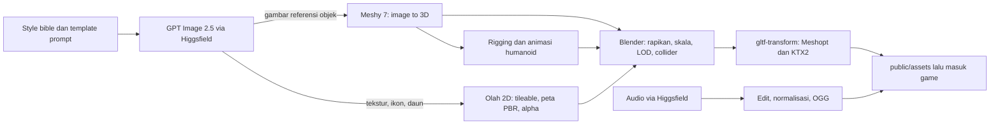

# 05 · Asset Pipeline

| | |
|---|---|
| Versi | 0.1 (draft untuk review) |
| Dokumen terkait | [Art Direction](04-art-direction.md) · [Technical Design](03-technical-design.md) |

Dokumen ini menjelaskan cara membuat aset game dengan **Higgsfield** sebagai pusat generasi: **GPT Image 2.5** untuk gambar dan tekstur, **Meshy 7** untuk model 3D. Setelah itu aset dirapikan di Blender dan dioptimasi menjadi glTF siap pakai di three.js.

> **Catatan status tool (Oktober 2026).** Model AI dan katalog platform berubah cepat. Sebelum produksi massal, cek ulang katalog dengan `higgsfield model list` dan `higgsfield model get <model>`, lalu perbarui dokumen ini bila ada perbedaan.

---

## 1. Ringkasan Alur



---

## 2. Peran Setiap Tool

| Tool | Dipakai untuk | Catatan |
|---|---|---|
| **Higgsfield** (web & CLI) | Pusat generasi gambar, 3D, audio, dan video | ID model di CLI: `gpt_image_2_5`, `image_to_3d`, `multi_image_to_3d`, `3d_rigging`, `mirelo_text_to_audio`, `sonilo_music`, `text2speech_v2`, serta model video (Veo 3.1, Kling 3.0, Seedance 2.5) |
| **GPT Image 2.5** | Style bible, concept art, gambar referensi untuk 3D, tekstur, atlas daun, ikon UI, ilustrasi jurnal, layar loading, panel prolog | Model gambar OpenAI (rilis 8 Sep 2026). Di Higgsfield tersedia varian `flare` (cepat, untuk eksplorasi) dan `sunburst` (lebih presisi, untuk aset final); `--background transparent`; hingga 16 gambar referensi; resolusi 1k/2k/4k |
| **Meshy 7** | Model 3D dari gambar (single image, atau multi-image hingga 4 sudut pandang), tekstur PBR, remesh ke target poligon, rigging dan animasi humanoid | Lewat Higgsfield (`image_to_3d` / `multi_image_to_3d`) atau langsung di meshy.ai. Lihat §2.1 |
| **Blender** (gratis) | Merapikan model, skala, origin, LOD, collider, vertex color angin, menggabung animasi, ekspor glTF | Versi stabil terbaru |
| **@gltf-transform/cli** | Optimasi: dedup, weld, simplify, Meshopt, KTX2, resize; validasi | KTX2 butuh **KTX-Software** (`toktx`) terpasang |
| Krita / GIMP / Photoshop | Tekstur tileable, koreksi warna, menghapus pencahayaan ter-*bake* | |
| Materialize / Substance 3D Sampler (opsional) | Membuat normal, roughness, dan AO dari albedo | |
| Gaea (opsional, ada versi gratis) | Heightmap pulau dengan erosi alami | |
| Audacity | Memotong, loop, dan normalisasi audio | |

### 2.1 Meshy 7 di Higgsfield
Parameter endpoint `image_to_3d` dan `multi_image_to_3d` di Higgsfield (`should_remesh`, `target_polycount`, `topology`, `symmetry_mode`, `pose_mode`, `enable_pbr`, `enable_rigging`, `animation_action_id`) sama persis dengan parameter API Meshy. Ini indikasi kuat bahwa keduanya memakai Meshy, tapi **versi modelnya belum terkonfirmasi**.
- **Langkah 1:** cek dengan `higgsfield model get image_to_3d`, atau lihat pilihan model di UI Higgsfield.
- **Kalau Meshy 7 tidak bisa dipilih di Higgsfield:** pakai **meshy.ai** langsung (web app atau API) dengan parameter yang sama. Alur di dokumen ini tetap berlaku.

Fitur Meshy 7 yang relevan: image-to-3D dan multi-image (hingga 4 sudut pandang); mode *Ultra* untuk input satu gambar; tekstur base color 2K/4K/8K dengan peta PBR opsional; output karakter dalam A-pose atau T-pose. Meshy 7.1 (September 2026) menambah *Ultra 4K*. Hasil Ultra bisa sangat padat (puluhan juta segitiga), jadi **selalu remesh** ke anggaran web.

---

## 3. Persiapan

```bash
# Pasang Higgsfield CLI (pilih salah satu)
npm install -g @higgsfield/cli
# atau: brew install higgsfield-ai/tap/higgsfield

higgsfield auth login             # token berumur pendek; ulangi bila "Session expired"
higgsfield model list             # katalog model yang tersedia untuk akun ini
higgsfield model get gpt_image_2_5   # parameter lengkap sebuah model
higgsfield generate --help        # termasuk subperintah cost/get/wait/list
```

- Pakai **paket berbayar** untuk aset final, karena output paket gratis bisa ber-watermark (§15).
- Catat biaya kredit per jenis aset saat uji pipeline (§16) untuk memperkirakan anggaran total.

---

## 4. Menjaga Konsistensi Gaya

Aset AI yang dibuat terpisah-pisah cenderung tidak seragam. Aturannya:

1. **Style bible dulu.** Buat dan setujui 8–12 gambar acuan sebelum produksi: pantai siang, laguna dari atas, hutan, rumah panggung, Bayu, satu set prop, satu set ikon, senja, dan malam. Simpan di `art/style-bible/`.
2. **Blok gaya standar.** Blok `STYLE` (di bawah) selalu disertakan di setiap prompt.
3. **Gambar referensi.** Setiap generasi GPT Image 2.5 menyertakan 2–4 gambar style bible yang paling relevan lewat `--image`. Untuk set ikon, sertakan juga ikon yang sudah disetujui.
4. **Palet terkunci.** Ikuti Art Direction §4. Koreksi warna akhir dilakukan di editor gambar bila melenceng.
5. **Art gate.** Setiap aset dicek dengan checklist §14.4 oleh satu orang yang sama sebelum masuk game.
6. **Catat asal-usul.** Prompt, model, varian, seed, parameter, dan tanggal dicatat di `art/provenance.csv` (§15).

---

## 5. Template Prompt

Prompt ditulis dalam bahasa Inggris, karena model gambar umumnya paling akurat dengan bahasa Inggris. Simpan sebagai berkas `.txt` di `art/prompts/`.

### 5.1 Blok Gaya Standar
```text
STYLE: cozy stylized game art of a tropical Indonesian island, soft hand-painted
textures, simplified rounded shapes, gentle saturated colors, warm sunlight,
soft blue-tinted shadows, clean and uncluttered, family-friendly.
No text, no watermark, no logo.
```

### 5.2 Concept Art / Style Bible
```text
Wide establishing shot of a small tropical island beach at noon: white sand,
leaning coconut palms, crystal-clear turquoise lagoon where the sandy bottom
is visible, a broken small wooden Indonesian fishing boat washed ashore,
fluffy cumulus clouds in a clean bright blue sky. {STYLE}
```

### 5.3 Gambar Referensi untuk Model 3D (satu objek)
```text
Single isolated {OBJECT}, {DETAILS}. Full object visible and centered,
3/4 front view, neutral even studio lighting, no cast shadows,
plain light gray background, simple readable silhouette,
stylized cozy game asset. {STYLE}
```

### 5.4 Turnaround Karakter (untuk multi-image)
```text
Character design sheet of Bayu, a 21-year-old Indonesian fisherman,
warm tan skin, short messy black hair, thick eyebrows, friendly face,
faded teal t-shirt with a small tear, cream cargo shorts, barefoot,
green-red checkered sarong tied over one shoulder, rope bracelet.
Full body, A-pose with arms 45 degrees from the body, neutral expression.
Separate views: front, left side, back. Consistent proportions, 6.5 heads tall,
flat even lighting, plain white background. {STYLE}
```
Potong lembar ini menjadi gambar terpisah (depan, samping, belakang) sebelum dikirim ke `multi_image_to_3d`.

### 5.5 Tekstur Tileable
```text
Seamless tileable top-down texture of {MATERIAL}, {DETAILS}.
Orthographic view, flat even diffuse lighting, no shadows, no specular
highlights, albedo color only, uniform scale, edges wrap seamlessly,
stylized hand-painted game texture, clean, not photographic.
Palette: {HEX COLORS}. No text, no border, no vignette.
```
Contoh `{MATERIAL}`: *white coral sand with tiny shell fragments*, *wet sand*, *short tropical grass*, *dark volcanic beach rock*, *woven bamboo wall panel (anyaman bambu)*, *dry palm-leaf thatch roof (atap rumbia)*, *weathered wooden planks*.

### 5.6 Atlas Daun & Vegetasi (transparan)
```text
Sprite sheet of {N} isolated {LEAF TYPE}, arranged in a grid with even spacing,
no overlap, flat front view, flat even lighting, stylized hand-painted,
{COLORS}. Transparent background.
```

### 5.7 Ikon UI (transparan)
```text
Game inventory icon of {ITEM}, cozy stylized hand-painted style, 3/4 view,
thin dark brown outline, soft light from the top-left, centered with padding,
matches the provided reference icons. Transparent background.
```

### 5.8 Sketsa Jurnal Pak Daeng
```text
Hand-drawn journal page sketch of {SUBJECT} with short handwritten-style notes
(illegible scribbles only), pencil and soft watercolor on aged cream paper,
warm and charming, old sailor's notebook.
```

### 5.9 Panel Prolog / Layar Loading
```text
Storybook illustration, {SCENE}, cinematic composition, 16:9,
soft painterly lighting, emotional but hopeful mood. {STYLE}
```
Adegan prolog: (1) perahu *Harapan Ibu* saat fajar; (2) Bayu memancing; (3) awan badai mendekat; (4) ombak raksasa; (5) layar gelap dengan serpihan perahu; (6) Bayu terbaring di pantai pagi hari.

---

## 6. Alur Tekstur (GPT Image 2.5)

1. **Generate** dengan `sunburst` resolusi 2k untuk aset final (eksplorasi cukup `flare` dengan kualitas `low`/`medium`):
   ```bash
   higgsfield generate create gpt_image_2_5 \
     --prompt "$(cat art/prompts/tex_terrain_sand_dry.txt)" \
     --aspect_ratio 1:1 --resolution 2k --quality high --variant sunburst \
     --image art/style-bible/sb_01_beach_noon.webp \
     --wait --json > art/generated/tex_terrain_sand_dry_v1.json

   # Unduh hasilnya (nama field mengikuti output --json; cek sekali di awal)
   curl -L -o art/generated/tex_terrain_sand_dry_v1.png \
     "$(jq -r '.result_url' art/generated/tex_terrain_sand_dry_v1.json)"
   ```
2. **Cek tileable:** geser 50% (offset) di Krita/GIMP, lalu tambal sambungan dengan clone atau heal. Model gambar tidak menjamin tekstur benar-benar seamless.
3. **Koreksi warna** ke palet, dan hilangkan sisa bayangan atau highlight.
4. **Buat peta PBR:** normal, roughness, dan AO dari albedo (Materialize / Substance Sampler, atau bake dari height di Blender). Normal map memakai konvensi **OpenGL (Y+)** seperti glTF; balik kanal hijau bila tool menghasilkan versi DirectX.
5. **Kemas ORM:** R = AO, G = Roughness, B = Metallic, sesuai susunan glTF.
6. **Simpan master** PNG 2k di `art/textures-src/`. Di game, tekstur model dikompres lewat `gltf-transform`; tekstur mandiri (terrain, air) dikonversi ke KTX2 dengan `toktx`.

---

## 7. Alur Model 3D (Meshy 7)

### 7.1 Gambar Referensi
Buat dengan template §5.3 (satu objek, sudut 3/4, latar polos). Untuk objek penting, buat 2–4 sudut pandang yang konsisten: generate tampak depan dulu, lalu pakai gambar itu sebagai `--image` referensi untuk tampak samping dan belakang.

### 7.2 Generate

```bash
# Prop statis: kelapa
higgsfield generate create image_to_3d \
  --image art/refs/prop_coconut_ref.png \
  --should_texture true --enable_pbr true \
  --should_remesh true --target_polycount 1500 --topology triangle \
  --symmetry_mode auto \
  --wait --json > art/generated/prop_coconut_v1.json

# Karakter: Bayu (multi-view, A-pose, langsung di-rig)
higgsfield generate create multi_image_to_3d \
  --image art/refs/char_bayu_front.png \
  --image art/refs/char_bayu_side.png \
  --image art/refs/char_bayu_back.png \
  --should_texture true --enable_pbr true \
  --should_remesh true --target_polycount 20000 --topology quad \
  --symmetry_mode on --pose_mode a-pose \
  --enable_rigging true --rigging_height_meters 1.72 \
  --wait --json > art/generated/char_bayu_v1.json
```

**Parameter per kelas aset:**

| Kelas | Input | `target_polycount` | `topology` | Catatan |
|---|---|---|---|---|
| Prop kecil (alat, buah, item) | 1 gambar | 500–2.000 | triangle | `symmetry_mode auto` |
| Prop besar dan stasiun | 1–2 gambar | 2.000–6.000 | triangle | |
| Batu | 1 gambar | 300–3.000 | triangle | Beberapa varian dari satu sesi |
| Batang pohon (tanpa daun) | 1 gambar | 1.500–4.000 | triangle | Daun dibuat terpisah (§8) |
| Hero prop (bangkai perahu, pondok) | 2–4 gambar | 10.000–20.000 | triangle | |
| Karakter (Bayu) | 3–4 gambar | 15.000–25.000 | quad | `pose_mode a-pose`, rigging, tinggi 1,72 m |
| Hewan | 2–4 gambar | 2.000–8.000 | quad | Rig manual di Blender (rig otomatis cenderung untuk humanoid) |
| Bagian bangunan modular | — | — | — | **Lebih baik dimodel manual di Blender** (lihat catatan) |

> **Bagian bangunan** butuh ukuran presisi (grid 2 m) dan titik snap yang rapi, sedangkan hasil AI jarang presisi. Modelkan bentuk sederhana (tiang, panel, atap) di Blender, lalu beri tekstur dari **trim sheet** buatan GPT Image 2.5. Hasilnya lebih cepat dan konsisten.

### 7.3 Merapikan di Blender (checklist)
1. Import GLB. Atur **skala nyata** (kelapa ±0,25 m, Bayu 1,72 m) dibandingkan dengan manekin acuan, lalu *Apply All Transforms*.
2. Letakkan **origin di dasar tengah**. Objek menghadap **−Y di Blender** (tampak depan), yang menjadi **+Z di glTF**.
3. Hapus bagian melayang dan face tersembunyi, *Merge by Distance*, perbaiki normal (*Recalculate Outside*), dan cek non-manifold.
4. **Cek albedo:** hapus bayangan atau highlight ter-*bake*. Bila parah, generate ulang tekstur (`--texture_prompt "flat albedo, no lighting"` atau `--texture_image_url`).
5. Sederhanakan material (idealnya 1 material) dan kecilkan resolusi tekstur ke anggaran (§14.2).
6. Buat **LOD** (Decimate collapse: LOD1 ±50%, LOD2 ±25%) bila objek sering terlihat dari jauh. Beri nama `_lod0`, `_lod1`, dan seterusnya.
7. Buat **collider proxy** sederhana (kotak, kapsul, atau convex) bernama `col_*` bila bentuk asli terlalu rumit.
8. Ekspor **glTF Binary (.glb)**: +Y up, *Apply Modifiers*, hanya objek terpilih, tanpa kompresi (kompresi dilakukan di langkah berikut).

### 7.4 Optimasi & Validasi

```bash
# Optimasi standar: dedup, weld, simplify ringan, Meshopt, tekstur KTX2
# (KTX2 otomatis: UASTC untuk normal/ORM, ETC1S untuk warna)
npx gltf-transform optimize art/export/prop_coconut.glb public/assets/models/prop_coconut.glb \
  --compress meshopt --texture-compress ktx2 --texture-size 1024

npx gltf-transform validate public/assets/models/prop_coconut.glb
npx gltf-transform inspect  public/assets/models/prop_coconut.glb   # cek jumlah segitiga, tekstur, ukuran
```

Script `tools/optimize-assets.ts` menjalankan langkah ini untuk semua file di `art/export/` dengan ukuran tekstur sesuai kelas aset, lalu memperbarui `manifest.json`.

### 7.5 Masuk Game
Letakkan hasil di `public/assets/models/`, daftarkan di manifest, lalu cek di **asset viewer** (scene debug dengan manekin 1,72 m, cahaya siang dan malam). Terakhir, isi checklist §14.4.

---

## 8. Vegetasi (Alur Khusus)

Pohon dan semak dari image-to-3D biasanya berat dan sulit dianimasikan angin. Karena itu dipakai alur gabungan:
1. **Batang dan cabang:** Meshy 7 (tanpa daun) atau dimodel manual di Blender.
2. **Daun:** atlas daun dari GPT Image 2.5 (template §5.6, `--background transparent`), dipotong menjadi kartu (quad atau bentuk daun) di Blender, lalu disusun di cabang.
3. **Vertex color angin:** R = besar ayunan (0 di pangkal, 1 di ujung), G = getar daun, B = fase acak per cabang (lihat Technical Design §8.6).
4. **Normal bulat:** salin normal dari bola pembungkus ke kartu daun (*Data Transfer*) agar pencahayaan semak lembut dan tidak terlihat "kartu".
5. **Rumput:** 1–3 atlas *clump* rumput (512²) di atas quad sederhana; animasi sepenuhnya di shader.
6. Target: pohon kelapa 2–4 rb segitiga, pohon hutan 4–8 rb, semak 300–1,5 rb.

---

## 9. Karakter & Animasi

### 9.1 Alur Bayu
1. Turnaround (template §5.4), lalu potong menjadi 3–4 gambar.
2. `multi_image_to_3d` dengan quad, A-pose, dan rigging (§7.2).
3. Tambahkan animasi. Cari ID gerakan di katalog, lalu terapkan ke model yang sudah di-rig:
   ```bash
   higgsfield preset list animation-action --query walk
   higgsfield preset list animation-action --query swim --json

   higgsfield generate create 3d_rigging \
     --model_url "<URL_GLB_BAYU>" --height_meters 1.72 \
     --enable_animation true --animation_action_id <ID> \
     --wait --json
   ```
   Cara lain: modul *Animate* di web app Meshy.
4. Import semua hasil ke Blender dan gabungkan ke **satu armature** sebagai *Actions* (satu klip per gerakan, nama sesuai tabel di bawah). Pastikan semua klip *in-place* dan 30 fps.
5. **Pisahkan mesh kepala dan rambut** (`char_bayu_head`) agar bisa disembunyikan di FPV.
6. Ekspor satu GLB berisi mesh, armature, dan semua klip.

### 9.2 Daftar Animasi Bayu

| Klip | Kegunaan | Prioritas |
|---|---|---|
| `idle`, `walk`, `run` | Gerak dasar | P0 |
| `jump_start`, `jump_loop`, `land` | Lompat | P0 |
| `pickup`, `interact` | Mengambil dan berinteraksi | P0 |
| `eat`, `drink` | Makan dan minum | P0 |
| `sit_ground`, `sleep` | Duduk (menonton sunset) dan tidur | P0 |
| `swim_idle`, `swim_forward`, `dive` | Berenang dan menyelam | P0 |
| `fish_cast`, `fish_reel` | Memancing | P0 |
| `wake_up` | Bangun di pantai (Bab 1) | P0 |
| `crouch_idle`, `crouch_walk` | Mengendap | P1 |
| `chop`, `mine`, `hoe`, `water` | Kapak, beliung, cangkul, siram | P1 |
| `spear_thrust`, `spear_throw`, `bow_draw`, `bow_shoot` | Berburu | P1 |
| `hammer` | Membangun | P1 |
| `climb_palm` | Memanjat pohon kelapa | P1 |
| `float_back` | Mengapung telentang | P1 |
| `hurt`, `faint` | Cedera dan pingsan | P1 |
| `wave` | Melambai ke helikopter (ending) | P1 |

Bila katalog tidak punya gerakan tertentu (misalnya lempar kail atau memanjat pohon kelapa), cadangannya adalah: animasi manual di Blender, Mixamo (cek ketersediaan dan lisensinya), atau tool *video-to-motion*. Animasi yang kurang tidak boleh menahan progres; pakai placeholder dulu.

### 9.3 Hewan
- **Babi hutan dan ayam hutan:** rig manual di Blender (Rigify atau armature sederhana) dengan animasi idle, jalan, lari, dan khusus (seruduk, mematuk, kepak).
- **Kepiting, ikan, ubur-ubur, penyu:** animasi prosedural di vertex shader (gelombang sinus sepanjang badan, kaki kepiting) tanpa skeleton.
- **Burung dan serangga jauh:** billboard atau partikel.

---

## 10. Terrain & Dunia
1. **Konsep peta:** gambar peta pulau dari atas dengan GPT Image 2.5 sebagai acuan tata letak zona (lihat GDD §4.2).
2. **Heightmap 16-bit 1025²:** dibuat di Gaea (erosi alami) atau dilukis di Krita (kuas lembut + blur), lalu diekspor sebagai PNG 16-bit.
3. **Mask:** splatmap (8 layer), zona/biome, dan kepadatan vegetasi, dilukis di Krita pada resolusi 1024².
4. **POI** disusun di `art/blender/world_layout.blend`, lalu diekspor ke `world_layout.glb`.
5. **Bake:** `tools/bake-world.ts` menghasilkan data runtime ke `public/assets/world/` (Technical Design §15).

---

## 11. UI, Ikon & Ilustrasi 2D

| Aset | Ukuran sumber | Format runtime | Catatan |
|---|---|---|---|
| Ikon item | 256² transparan | Atlas WebP/PNG, ditampilkan 64–128 px | Selalu pakai referensi ikon yang sudah disetujui |
| Panel, bingkai, tombol UI | Sesuai kebutuhan | PNG/WebP 9-slice atau CSS | Tekstur kertas tileable 512² |
| Sketsa jurnal Pak Daeng | 1024² | WebP | Template §5.8 |
| Layar loading | 2k, 16:9 | WebP | 4 ilustrasi |
| Panel prolog | 2k, 16:9 | WebP | 6 panel, dianimasikan parallax ringan di game |
| Peta jurnal | 2048² | WebP | Gaya gambar tangan |
| Logo | 2k | SVG (digambar ulang) + PNG | GPT Image 2.5 bagus untuk eksplorasi tipografi, tapi logo final digambar ulang sebagai vektor |

Untuk ikon dan aset transparan lain, gunakan `--background transparent`. Bila hasilnya kurang bersih, gunakan model `image_background_remover` di Higgsfield.

---

## 12. Audio

| Jenis | Sumber | Contoh |
|---|---|---|
| SFX & ambience | Higgsfield `mirelo_text_to_audio` | `--prompt "gentle ocean waves lapping on a white sand beach, calm, close perspective, no music" --duration 20` |
| Musik | Higgsfield `sonilo_music` | `--prompt "cozy acoustic island music, soft ukulele and Indonesian sape lute, bamboo flute, warm and peaceful, 80 bpm, loopable" --duration 60` |
| Suara / narasi (opsional) | Higgsfield `text2speech_v2` (varian `elevenlabs`, `cozy_voice`, dll.) | Gumaman Bayu, suara radio |
| Cadangan | Pustaka CC0 (Freesound CC0, Kenney) | Suara spesifik yang sulit di-generate, misalnya tokek |

Batas durasi tiap model dicek dengan `higgsfield model get <model>`.

**Pengolahan:**
- Potong hening dan beri fade. Ambience dan musik dibuat **loop mulus** (cari titik loop di Audacity).
- Normalisasi: musik ±−16 LUFS, ambience ±−20 LUFS, SFX dengan puncak −3 dBFS.
- Ekspor OGG 96–128 kbps. SFX posisional dibuat **mono**; ambience dan musik stereo.
- Penamaan: `sfx_*`, `amb_*`, `mus_*`, `vo_*`.

---

## 13. Video (Opsional)
- **Trailer dan materi promosi:** model video di Higgsfield (Veo 3.1, Kling 3.0, Seedance 2.5), memakai still dari style bible sebagai frame awal agar gayanya konsisten.
- **Prolog di dalam game:** direkomendasikan **panel storybook** (§5.9) dengan parallax ringan, ditambah sekuens perahu in-engine. Gayanya lebih konsisten dengan game dan ukuran unduhannya kecil. Video hasil AI dipertimbangkan bila konsistensinya sudah teruji.

---

## 14. Spesifikasi Teknis

### 14.1 Konvensi
- **Satuan:** 1 unit = 1 meter.
- **Orientasi glTF:** +Y ke atas, objek menghadap +Z (di Blender: menghadap −Y).
- **Origin:** dasar tengah objek (di kaki untuk karakter).
- **Format:** model `.glb`; tekstur sumber PNG; tekstur runtime KTX2; audio OGG; UI WebP/PNG.
- **Penamaan file:** `{kategori}_{nama}[_{varian}][_lod{n}]`, huruf kecil, bahasa Inggris, `snake_case`. Kategori: `char`, `fauna`, `tree`, `plant`, `rock`, `prop`, `tool`, `bld` (bagian bangunan), `fur` (perabot), `stn` (stasiun), `crop`, `fx`, `tex`, `ui`, `sfx`, `amb`, `mus`, `vo`.
  - Contoh: `char_bayu.glb`, `tree_palm_a_lod0`, `prop_coconut_open.glb`, `bld_bamboo_wall.glb`, `crop_cassava_s3`, `tex_terrain_sand_dry_basecolor.png`.

### 14.2 Anggaran per Kelas Aset

| Kelas | Segitiga LOD0 | LOD | Tekstur | Catatan |
|---|---|---|---|---|
| Karakter utama (Bayu) | 15–25 rb | LOD1 8 rb (opsional) | 2048² (base color, normal, ORM) | Skinned, ≤ 65 tulang |
| Hewan besar (babi hutan) | 5–8 rb | LOD1 2,5 rb | 1024² | Skinned |
| Hewan kecil (ayam, kepiting) | 1,5–3 rb | — | 512² | |
| Ikan | 0,5–1,5 rb | — | Atlas 512² | Animasi vertex shader |
| Pohon kelapa | 2–4 rb | LOD1 1 rb | Batang 1024² + atlas daun 1024² | Vertex color angin |
| Pohon hutan besar | 4–8 rb | LOD1 2 rb, LOD2 600 | Batang 1024² + atlas daun 2048² | |
| Semak & tanaman kecil | 0,3–1,5 rb | LOD1 300 | Atlas 1024² | Instanced |
| Rumpun rumput | 30–80 | — | Atlas 512² | Instanced, tanpa bayangan |
| Batu | 0,2–3 rb | 50% / 25% | 1024² (material batu bersama) | |
| Prop kecil & alat | 0,3–2 rb | — | 512² | |
| Stasiun & prop besar | 2–6 rb | LOD1 50% | 1024² | |
| Bagian bangunan | 0,2–1,5 rb | — | Trim sheet 2048² bersama | Instanced |
| Hero prop (bangkai perahu) | 10–20 rb | LOD1 5 rb | 2048² | |
| Tanaman kebun (per tahap) | 0,2–1 rb | — | Atlas 1024² | 4 tahap per tanaman |

### 14.3 Tekstur
- Ukuran selalu pangkat dua (512, 1024, 2048). Ukuran 4096 hanya untuk splatmap terrain bila perlu.
- **Ruang warna:** base color dan emissive memakai sRGB; normal, ORM, dan mask memakai linear.
- **Kompresi KTX2:** ETC1S untuk warna (kecil), UASTC untuk normal dan ORM (berkualitas). `gltf-transform optimize --texture-compress ktx2` mengatur pembagian ini otomatis.
- Mipmap selalu aktif. Atlas diberi padding ≥ 8 px agar tidak bocor di mip rendah.

### 14.4 Checklist "Siap Masuk Game"
- [ ] Skala benar (dibandingkan dengan manekin 1,72 m), origin di dasar tengah, transform sudah di-apply
- [ ] Menghadap +Z di glTF
- [ ] Jumlah segitiga sesuai anggaran, dan ada LOD bila perlu
- [ ] Normal benar; tidak ada face terbalik, tersembunyi, atau melayang
- [ ] Material sesedikit mungkin; tekstur sesuai resolusi anggaran
- [ ] Albedo tanpa pencahayaan ter-*bake*; warna sesuai palet
- [ ] Collider proxy (`col_*`) bila perlu
- [ ] Vegetasi: vertex color angin sudah dicat
- [ ] Animasi: nama klip sesuai daftar, in-place, 30 fps
- [ ] Sudah dioptimasi (Meshopt + KTX2) dan lolos `gltf-transform validate`
- [ ] Sudah dicek di asset viewer pada siang dan malam
- [ ] Baris `art/provenance.csv` sudah diisi

---

## 15. Struktur Folder, Asal-usul & Lisensi

### 15.1 Struktur Folder
```
art/                         # sumber kreatif
├── style-bible/             # gambar acuan yang disetujui (WebP ≤ 500 KB) — commit
├── prompts/                 # template prompt (.txt) — commit
├── refs/                    # gambar referensi untuk image-to-3D — commit bila kecil
├── provenance.csv           # catatan asal-usul semua aset — commit
├── generated/               # hasil mentah Higgsfield/Meshy — JANGAN di-commit (simpan di Google Drive)
├── blender/                 # file .blend — Git LFS atau Google Drive
├── textures-src/            # tekstur master 2k/4k — Git LFS atau Google Drive
└── export/                  # GLB dari Blender sebelum optimasi — tidak di-commit
public/assets/               # aset runtime teroptimasi — commit
├── models/  textures/  audio/  ui/  world/
└── manifest.json            # dibuat oleh tools/build-manifest.ts
```

Repo hanya menyimpan file ringan dan aset runtime yang sudah dioptimasi. File mentah yang besar tidak masuk riwayat git biasa supaya repo tetap cepat di-clone.

### 15.2 Catatan Asal-usul (`art/provenance.csv`)
Kolom: `asset_id, file, tool, model, variant_params, prompt_file, seed, date, author, license_note`.

Catatan ini berguna untuk konsistensi (generate ulang dengan parameter sama), audit lisensi, dan **pengungkapan konten AI**. Steam, misalnya, mewajibkan developer mengungkapkan penggunaan konten AI generatif di formulir konten.

### 15.3 Lisensi (wajib dicek ulang sebelum rilis)
- **Higgsfield:** menurut help center Higgsfield, hasil generasi boleh dipakai komersial di semua paket dan Higgsfield tidak mengklaim kepemilikan. Output paket gratis bisa ber-watermark, jadi **aset final dibuat dengan paket berbayar**. Baca *Terms of Use* terbaru.
- **Meshy (bila dipakai langsung di meshy.ai):** menurut dokumentasi Meshy, semua paket berbayar mendukung penggunaan komersial. Paket gratis dilaporkan memakai lisensi CC BY 4.0 (wajib atribusi) dan membatasi unduhan, dan mengunduh model Meshy 7 disebut butuh paket Pro. Pakai paket berbayar untuk aset final.
- **Prompt:** jangan memakai nama karakter, merek, atau "gaya [seniman yang masih hidup]" di prompt.
- **Font** (Baloo 2, Nunito) berlisensi SIL OFL, aman untuk game komersial.
- **Audio pihak ketiga:** utamakan CC0. Bila CC BY, cantumkan di kredit.

---

## 16. Uji Pipeline (Fase 0, sebelum produksi massal)

| # | Uji | Lolos bila |
|---|---|---|
| 1 | Tekstur pasir: GPT Image 2.5 → tileable → KTX2 → terrain uji | Tidak ada sambungan terlihat dan warna sesuai palet |
| 2 | Prop kelapa: gambar referensi → Meshy 7 → Blender → `optimize` → asset viewer | ≤ 2 rb segitiga, ≤ 300 KB, tampil benar siang dan malam |
| 3 | Bayu: turnaround → multi-image 3D → rig → animasi `walk` → berjalan di graybox | Proporsi sesuai desain, rig tidak rusak, mesh kepala bisa disembunyikan |

Untuk setiap uji, catat **waktu kerja, kredit yang terpakai, dan masalah**, lalu perbarui dokumen ini (parameter, template prompt, perkiraan anggaran) sebelum lanjut produksi.

---

## 17. Daftar Aset

**Prioritas:** **P0** = vertical slice (Pantai Karam + Laguna, Hari 1) · **P1** = rilis 1.0 · **P2** = nanti (*Should/Could*).

### 17.1 Karakter & Hewan

| Aset | Jumlah | Prioritas |
|---|---|---|
| Bayu (rig, kepala terpisah) | 1 | P0 |
| Animasi Bayu P0 / P1 (§9.2) | 18 / 16 klip | P0 / P1 |
| Kepiting pantai | 1 | P0 |
| Ikan: belanak, baronang, kakatua | 3 | P0 |
| Ikan lainnya (§11 Konten & Balancing) | 9 | P1 |
| Ayam hutan, babi hutan (+ anak babi), penyu, camar, ubur-ubur, kelomang, kepiting bakau, udang | 9 | P1 |
| Kupu-kupu, kunang-kunang, capung (partikel/billboard) | 3 | P1 |
| Lumba-lumba, hiu karang, biawak, kalong | 4 | P2 |

### 17.2 Vegetasi & Batu

| Aset | Jumlah | Prioritas |
|---|---|---|
| Pohon kelapa (lurus, condong, tinggi) | 3 varian | P0 |
| Ketapang, pandan, semak pantai ×2, rumput pantai | 5 | P0 |
| Lamun, rumput laut, karang ×4 | 6 | P0 |
| Batu pantai ×3, batu besar ×2 | 5 | P0 |
| Pohon hutan ×2, rumpun bambu, pisang, pepaya, mangga, waru, damar | 8 | P1 |
| Semak beri ×2, jamur ×2, pakis, bunga ×3 (termasuk kembang sepatu), kangkung, talas, rumput hutan | 11 | P1 |
| Tebing ×3, Batu Karang (formasi), batu sungai | 5 | P1 |
| Bakau, sagu | 2 | P2 |

### 17.3 Props, Alat & POI

| Aset | Jumlah | Prioritas |
|---|---|---|
| Bangkai haluan *Harapan Ibu* (hero) | 1 | P0 |
| Puing: terpal, papan, jeriken, radio rusak | 4 | P0 |
| Kelapa (utuh, terbuka, batok), botol, kaleng, biskuit, sarden | 7 | P0 |
| Bundel item umum (untuk item kecil yang dijatuhkan) | 1 | P0 |
| Alat dipegang: pisau, joran ayah + pelampung, korek, kapak batu, tombak kayu | 5 | P0 |
| Alat lain: beliung, palu batu/besi, cangkul, parang, gergaji, tombak batu/besi, busur & panah, ketapel, joran bambu, obor, penyiram | 13 | P1 |
| Perahu utuh *Harapan Ibu* (prolog) | 1 | P1 |
| Kotak perkakas, buritan perahu, aki kapal, peti hanyut, kotak P3K | 5 | P1 |
| Reruntuhan pondok Pak Daeng | 1 | P1 |
| Helikopter SAR, perahu nelayan desa (ending) | 2 | P1 |

### 17.4 Bangunan, Stasiun & Perabot

| Aset | Jumlah | Prioritas |
|---|---|---|
| Api unggun (padam, menyala, bara), bivak, kasur daun | 3 | P0 |
| Set bambu: tiang, lantai, dinding, dinding jendela, pintu, atap miring, bubungan, sudut atap, tangga, pagar | 10 | P1 |
| Set papan: lantai, dinding, dinding jendela, pintu | 4 | P1 |
| Stasiun: meja kerja, tungku masak, rak pengering, tungku tanah liat, peti, penampung hujan, penyuling surya, tambak garam, bak kompos, orang-orangan sawah, petak kebun (4 kondisi tanah), bubu, jerat | 13 | P1 |
| Bangunan cerita: tanda SOS, menara api, antena bambu, stasiun radio | 4 | P1 |
| Perabot: ranjang bambu, hammock, tikar, bangku, meja, pelita, obor dinding, pot bunga, lonceng angin, hiasan kerang, rak koleksi | 11 | P1 |
| Tanaman kebun: 9 jenis × 4 tahap | 36 | P1 |
| Set batu: fondasi, dinding bata, sumur | 3 | P2 |

### 17.5 Tekstur, UI & 2D

| Aset | Jumlah | Prioritas |
|---|---|---|
| Layer terrain: pasir kering, pasir basah, rumput, batu | 4 | P0 |
| Layer terrain: tanah, tebing, lumpur, karang | 4 | P1 |
| Air: normal map ×2, buih, kaustik | 4 | P0 |
| Awan, atlas partikel (debu, cipratan, api, asap, daun) | 2 | P0 |
| Trim sheet: bambu, kayu, atap rumbia | 3 | P1 |
| Ikon item (Hari 1 / semua) | ±20 / ±120 | P0 / P1 |
| Panel UI, tekstur kertas, font | 1 set | P0 |
| Logo, 4 layar loading, 6 panel prolog, 10 sketsa jurnal, peta jurnal | 22 | P1 |

### 17.6 Audio

| Aset | Jumlah | Prioritas |
|---|---|---|
| Ambience: ombak dekat/jauh, angin di daun kelapa, malam (jangkrik + tokek) | 4 | P0 |
| Ambience: hutan siang, bawah air, hujan di daun/atap, badai, mata air | 6 | P1 |
| SFX dasar (langkah pasir/air, pungut, racik, api, minum, makan, UI, pancing) | ±25 | P0 |
| SFX lengkap | ±80 | P1 |
| Musik (P0: 1–2 trek siang) | 8 trek | P0 / P1 |
| Gumaman Bayu, suara radio | ±30 klip | P1 |
| Voice over penuh | — | P2 |

---

## Referensi
- Higgsfield CLI, daftar model dan parameter: <https://github.com/higgsfield-ai/cli>
- Pengumuman GPT Images 2.5 (OpenAI Developer Community): <https://community.openai.com/t/introducing-gpt-images-2-5-in-the-api-and-chatgpt/1395897>
- Meshy: panduan remesh <https://docs.meshy.ai/en/webapp/guides/3d-model/remesh> dan harga/paket <https://docs.meshy.ai/en/webapp/pricing>
- Ringkasan varian Meshy 7 (Scenario): <https://help.scenario.com/articles/5709143930-meshy-the-essentials>
- Higgsfield, kepemilikan dan penggunaan komersial: <https://higgsfield.ai/creator-hub/help-center/account/who-owns-my-generations-and-can-i-use-them-commercially>
- glTF Transform CLI: <https://gltf-transform.dev/cli>
