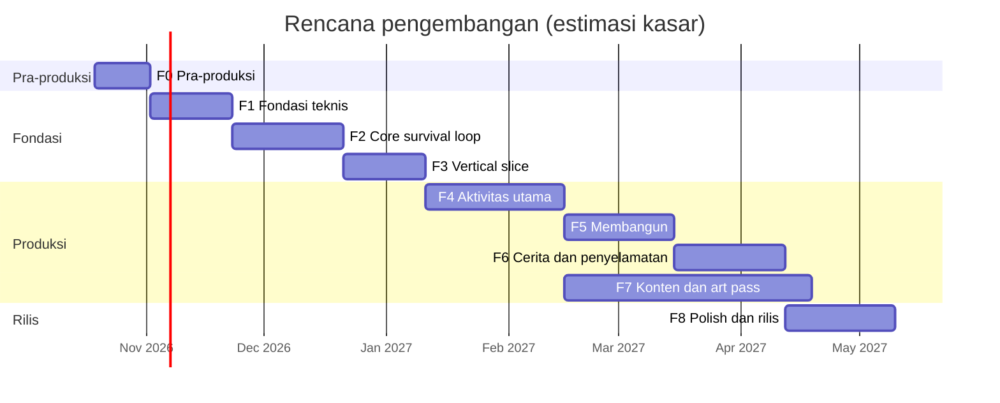

# 06 · Roadmap

| | |
|---|---|
| Versi | 0.1 (draft untuk review) |
| Status saat ini | **Fase 0: Pra-produksi** |
| Dokumen terkait | Semua dokumen di `docs/` |

---

## 1. Prinsip Perencanaan

1. **Vertical slice dulu.** Satu potong game (Hari 1 di Pantai Karam dan Laguna) dibuat dengan kualitas final sebelum konten diperluas. Ini menguji dua hal terpenting sekaligus: apakah tampilannya benar-benar cozy, dan apakah loop-nya menyenangkan.
2. **Selalu bisa dimainkan.** Setiap fase berakhir dengan build yang bisa dibuka lewat link (preview Vercel).
3. **Risiko terbesar dikerjakan paling awal:** shader air, kamera TPV/FPV, dan pipeline aset AI.
4. **Data-driven.** Konten dan angka ada di `src/data/`, jadi balancing tidak perlu mengubah logika.
5. **Must dulu, Should/Could belakangan** (GDD §15).

**Asumsi estimasi:** 1 developer, ±20 jam per minggu, dibantu AI (Claude Code untuk kode, Higgsfield untuk aset). Ini **estimasi kasar** yang akan dihitung ulang setelah vertical slice (M3).

---

## 2. Ringkasan Fase

| Fase | Nama | Durasi | Hasil utama |
|---|---|---|---|
| F0 | Pra-produksi | 2 minggu | Dokumen, style bible, uji pipeline aset, prototipe air dan kamera |
| F1 | Fondasi teknis (graybox) | 3 minggu | Jalan-jalan di pulau graybox dengan TPV/FPV, laut, langit, siklus hari |
| F2 | Core survival loop | 4 minggu | Hari 1 bisa dimainkan dengan aset placeholder |
| F3 | Vertical slice "Hari Pertama" | 3 minggu | Pantai dan laguna berkualitas final, memancing, berenang, playtest #1 |
| F4 | Aktivitas utama | 5 minggu | Memancing lengkap, menyelam, foraging, berburu, berkebun, zona baru |
| F5 | Membangun | 4 minggu | Mode bangun, rumah panggung, stasiun, perabot, kenyamanan |
| F6 | Cerita & penyelamatan | 4 minggu | Prolog sampai ending, quest, Harapan, badai |
| F7 | Konten & art pass penuh | 9 minggu (paralel dengan F5–F6) | Semua aset, audio, dan UI final |
| F8 | Polish, optimasi & rilis | 4 minggu | Balancing, performa, aksesibilitas, rilis 1.0 |

---

## 3. Milestone

| Milestone | Perkiraan | Isi |
|---|---|---|
| **M0**, Pra-produksi selesai | Awal Nov 2026 | Dokumen disetujui, style bible, 3 uji pipeline lolos |
| **M1**, Graybox | Akhir Nov 2026 | Berjalan keliling pulau dengan TPV/FPV, laut, dan siklus hari |
| **M2**, Core loop | Akhir Des 2026 | Hari 1 bisa dimainkan (placeholder) |
| **M3**, Vertical slice | Pertengahan Jan 2027 | Build publik pertama, playtest #1, **estimasi ulang jadwal** |
| **M4**, Alpha (fitur lengkap) | Pertengahan Apr 2027 | Semua fitur ada; game bisa ditamatkan |
| **M5**, Beta (konten lengkap) | Akhir Apr 2027 | Tanpa placeholder; playtest #2 dan #3 |
| **M6**, Rilis 1.0 | Mei 2027 | Rilis web (itch.io dan Vercel) |

---

## 4. Rincian Fase

Centang tugas saat selesai, dan tautkan PR terkait bila ada.

### F0: Pra-produksi (2 minggu)
- [x] Dokumen desain: GDD, konten & balancing, technical design, art direction, asset pipeline, roadmap
- [ ] Konfirmasi keputusan terbuka (§6)
- [ ] Siapkan akun dan langganan tool (Higgsfield; Meshy bila dipakai langsung), serta folder Google Drive untuk aset mentah
- [ ] Moodboard dan **style bible** 8–12 gambar (Asset Pipeline §4)
- [ ] **Uji pipeline aset:** tekstur pasir, prop kelapa, Bayu berjalan (Asset Pipeline §16)
- [ ] **Prototipe teknis:** shader air (warna kedalaman + refraksi + buih) dan kamera TPV/FPV di scene sederhana

**Selesai bila:** style bible disetujui, 3 uji pipeline lolos, dan prototipe air ≥ 60 FPS di perangkat acuan.

### F1: Fondasi Teknis / Graybox (3 minggu)
- [ ] Setup repo: Vite + TypeScript strict, ESLint + Prettier, Vitest, Playwright, GitHub Actions, preview Vercel
- [ ] Renderer, game loop fixed-step, input + Pointer Lock, event bus, World (ECS), RNG ber-seed
- [ ] `AssetLoader` (GLTF + KTX2 + Meshopt) dan manifest
- [ ] Terrain graybox dari heightmap kasar + collider heightfield
- [ ] Laut v1 (Gerstner + warna kedalaman), langit (addon `Sky`), siklus hari
- [ ] Karakter kapsul + `KinematicCharacterController` (jalan, lari, lompat, jongkok)
- [ ] `CameraRig`: TPV dengan tabrakan, FPV, ganti mode (V), zoom
- [ ] Panel debug, overlay performa, preset kualitas dasar

**Selesai bila:** pemain bisa berjalan keliling pulau graybox dengan TPV/FPV yang mulus pada 60 FPS, CI hijau, dan build preview bisa dibuka dari link.

### F2: Core Survival Loop (4 minggu)
- [ ] Data layer `src/data/` + tes validasi data
- [ ] Inventaris, hotbar, dan UI tas (Preact)
- [ ] Stat survival, status, dan HUD
- [ ] Node sumber daya (ranting, batu, kelapa, serat) + registry + tumbuh kembali
- [ ] Interaksi dan alat (pisau, kapak batu) + event animasi (memakai manekin)
- [ ] Racik tangan, api unggun (bahan bakar, dinyalakan dengan korek), memasak dasar
- [ ] Minum: air kelapa, wadah, porsi air
- [ ] Bivak, tidur, dan lompat waktu
- [ ] Save/load v1 (IndexedDB) + autosave
- [ ] Kerangka i18n (Indonesia/Inggris)

**Selesai bila:** loop Hari 1 bisa dimainkan dari bangun sampai tidur (aset placeholder), save/load berfungsi, dan unit test logika lulus.

### F3: Vertical Slice "Hari Pertama" (3 minggu)
- [ ] Pantai Karam dan Laguna dengan aset final P0 (Asset Pipeline §17)
- [ ] Air final: refraksi, buih, kaustik, pasir basah, efek bawah air
- [ ] Vegetasi final dengan angin + rumput instanced
- [ ] Bayu final (rig + animasi P0); kamera dipoles
- [ ] Memancing v1: lempar, gigitan, minigame, 3 jenis ikan, memasak ikan
- [ ] Berenang dan menyelam dasar
- [ ] Kubah langit custom, color script, post-processing (bloom, LUT, SMAA)
- [ ] Ambience, SFX dasar, 1 trek musik
- [ ] Onboarding 30 menit pertama (GDD §7.3)
- [ ] **Playtest #1** (5–10 orang) + survei singkat

**Selesai bila:** ada build publik yang menampilkan tampilan final, playtest menilai loop-nya menyenangkan, dan performa sesuai anggaran *Sedang*. Lalu **hitung ulang jadwal**.

### F4: Aktivitas Utama (5 minggu)
- [ ] Memancing lengkap: 12+ ikan, bubu, umpan, joran bambu, ensiklopedia ikan, pesan dalam botol
- [ ] Menyelam lengkap: oksigen, kacamata selam, kantong udara, ubur-ubur, konten bawah laut
- [ ] Foraging, identifikasi tanaman, ensiklopedia tanaman
- [ ] Berburu: AI kepiting, ayam hutan, babi hutan; tombak, busur, ketapel, jerat; hasil buruan
- [ ] Berkebun: petak, tanam, siram, tumbuh, panen, kompos, pagar, orang-orangan sawah
- [ ] Zona Hutan, Mata Air, Bukit, dan Pondok (graybox → aset P1 bertahap)
- [ ] Cuaca: hujan ringan (visual + gameplay)

**Selesai bila:** semua aktivitas di GDD §8.1–8.5 bisa dimainkan dan balancing awal mengikuti Konten & Balancing.

### F5: Membangun (4 minggu)
- [ ] Mode bangun: ghost preview, snapping soket/grid, validasi, rotasi, bongkar
- [ ] Set bambu dan papan; tiang di air dangkal
- [ ] Meja kerja dan semua stasiun (Konten & Balancing §13.2)
- [ ] Perabot, sistem Kenyamanan, buff Segar
- [ ] Peti penyimpanan; racik dan bangun memakai bahan dari peti terdekat

**Selesai bila:** rumah panggung lengkap bisa dibangun sesuai quest `q_house`, dan game tetap 60 FPS dengan rumah berisi 100+ bagian.

### F6: Cerita & Penyelamatan (4 minggu)
- [ ] Sistem quest data-driven dan jurnal (Tujuan, Catatan)
- [ ] Prolog: perahu, tutorial memancing, sekuens badai, panel storybook
- [ ] Bab 1–5 lengkap (Konten & Balancing §15) + meter Harapan
- [ ] Event terjadwal: kapal lewat, pesawat, peti hanyut, radio malam
- [ ] Rantai radio, menara api, tanda SOS
- [ ] Event badai (visual, audio, gameplay) dan persiapannya
- [ ] Ending (helikopter, reuni), kartu epilog, free play
- [ ] Monolog dan semua teks cerita (Indonesia/Inggris)

**Selesai bila:** game bisa ditamatkan dari prolog sampai ending tanpa cheat.

### F7: Konten & Art Pass Penuh (9 minggu, paralel dengan F5–F6)
- [ ] Semua aset P1 (Asset Pipeline §17)
- [ ] Musik dan SFX lengkap, ambience semua zona
- [ ] UI final: ikon, panel, peta, sketsa jurnal, layar loading
- [ ] VFX lengkap
- [ ] Lokalisasi bahasa Inggris lengkap

**Selesai bila:** tidak ada lagi placeholder di build.

### F8: Polish, Optimasi & Rilis (4 minggu)
- [ ] Balancing berdasarkan data playtest
- [ ] Optimasi per preset; uji di perangkat acuan, Safari, dan Firefox
- [ ] Aksesibilitas (remap tombol, toggle, kurangi gerakan, ukuran teks) dan gamepad
- [ ] Menu pengaturan lengkap dan deteksi preset otomatis
- [ ] Bug bash, termasuk kasus khusus save/load
- [ ] Halaman itch.io, trailer, dan screenshot; rilis web

**Selesai bila:** rilis 1.0.

---

## 5. Risiko

| # | Risiko | Dampak | Peluang | Mitigasi |
|---|---|---|---|---|
| R1 | Gaya aset AI tidak konsisten | Tinggi | Tinggi | Style bible, gambar referensi di setiap generasi, blok gaya standar, art gate, koreksi warna, trim sheet bersama |
| R2 | Aset AI tidak siap pakai (poligon tinggi, topologi berantakan, bayangan ter-*bake*, tekstur tidak tileable) | Tinggi | Tinggi | Remesh, checklist Blender, perbaikan albedo, bangunan dimodel manual, uji pipeline di F0 |
| R3 | Performa browser (air + vegetasi + bayangan) | Tinggi | Sedang | Prototipe air di F0, anggaran performa, preset kualitas, profiling di setiap milestone |
| R4 | Scope creep | Tinggi | Tinggi | MoSCoW, vertical slice dulu, fitur *Should/Could* hanya setelah semua *Must* selesai |
| R5 | Animasi khusus kurang (memancing, memanjat) | Sedang | Sedang | Katalog animasi Meshy/Higgsfield, Mixamo, animasi manual di Blender, placeholder |
| R6 | Lisensi atau ketentuan tool AI berubah | Sedang | Sedang | Paket berbayar, catatan provenance, arsip prompt dan output, cek ToS sebelum rilis |
| R7 | Survival terlalu berat, atau terlalu ringan untuk game cozy | Sedang | Sedang | Tingkat kesulitan, playtest berkala, semua angka di satu tempat (`balance.ts`) |
| R8 | Kompatibilitas browser (Safari, Firefox) | Sedang | Sedang | Uji lintas browser di setiap milestone, audio cadangan, hindari ekstensi WebGL yang jarang didukung |
| R9 | Ukuran unduhan besar | Sedang | Sedang | KTX2 + Meshopt, bundel `core`/`deferred`, anggaran aset |
| R10 | Katalog model AI berubah (misalnya Meshy 7 tidak tersedia di Higgsfield) | Rendah | Sedang | Pipeline tidak bergantung pada satu platform; meshy.ai langsung sebagai cadangan |

---

## 6. Keputusan Terbuka

Rekomendasi di bawah dipakai sebagai asumsi kerja sampai dikonfirmasi.

| # | Keputusan | Rekomendasi | Dampak bila berubah |
|---|---|---|---|
| 1 | Judul final dan nama tokoh | *Terdampar* dan *Bayu* (sementara) | Teks dan logo |
| 2 | Gaya visual | Stylized PBR yang cozy (Art Direction §3) | Seluruh pipeline aset |
| 3 | Platform | Browser desktop dulu; desktop app (Tauri/Electron → Steam) setelah 1.0 | Input, performa, distribusi |
| 4 | Bahasa | Indonesia + Inggris sejak awal | Volume teks dan waktu lokalisasi |
| 5 | Model bisnis | Gratis di web/itch.io (dengan opsi donasi), lalu evaluasi versi Steam berbayar | Hosting, lisensi aset |
| 6 | Hewan berbahaya | Hiu hanya ada di mode Survival | Desain AI dan nada game |
| 7 | Voice over | Teks + gumaman di 1.0; voice over menyusul | Anggaran audio |
| 8 | Langganan tool AI | Higgsfield berbayar; Meshy Pro bila Meshy 7 dipakai langsung | Biaya bulanan |
| 9 | Penyimpanan aset mentah | Google Drive, ditambah Git LFS untuk file `.blend` | Alur kerja tim |

---

## 7. Langkah Berikutnya

1. **Review dokumen** dan jawab keputusan terbuka di §6.
2. **Buat style bible** dengan GPT Image 2.5 di Higgsfield (Asset Pipeline §4–5).
3. **Uji pipeline aset:** tekstur pasir, prop kelapa, Bayu berjalan (Asset Pipeline §16).
4. **Prototipe air dan kamera**, risiko teknis terbesar.
5. **Mulai F1:** setup project (Vite + TypeScript + three.js + Rapier) dan graybox pulau.
